# Apêndice B — Manual do Usuário do SGA TI

**Sistema de Gerenciamento de Assistência Técnica**
Versão 1 · Outubro de 2026

---

## Sumário

1. [Antes de começar](#1-antes-de-começar)
2. [O fluxo completo de um atendimento](#2-o-fluxo-completo-de-um-atendimento)
3. [Manual do Atendente](#3-manual-do-atendente)
4. [Manual do Vendedor](#4-manual-do-vendedor)
5. [Manual do Técnico](#5-manual-do-técnico)
6. [Manual do setor de Compras](#6-manual-do-setor-de-compras)
7. [Manual do Financeiro](#7-manual-do-financeiro)
8. [Manual do Administrador](#8-manual-do-administrador)
9. [Para o cliente — consulta pública](#9-para-o-cliente--consulta-pública)
10. [Perguntas frequentes](#10-perguntas-frequentes)

> **Sobre as imagens:** as capturas estão em `docs/prints/`, em PNG com o dobro
> da resolução de tela (2560 px de largura na página inteira), adequadas para
> impressão. Foram feitas com a massa de demonstração, cada uma com o perfil a
> que a seção se refere. Uma única captura depende de programa externo e ficou
> marcada como `[PRINT: ...]`: o CSV aberto no Excel.

---

## 1. Antes de começar

### Entrando no sistema

Acesse o endereço do sistema e informe **login** e **senha**. Não há cadastro
público: quem cria usuários é o administrador.

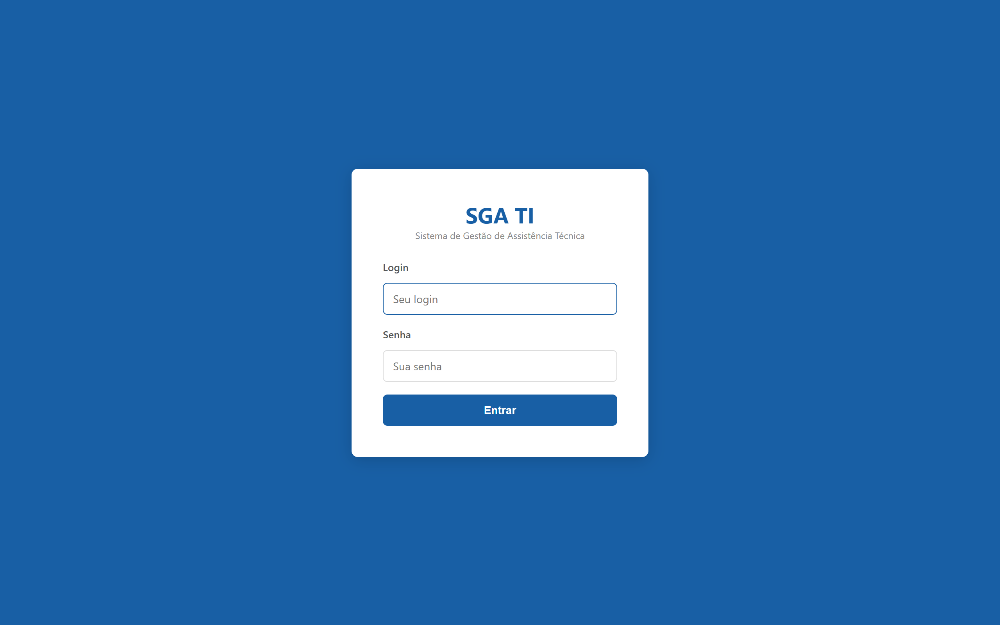

Se errar, a mensagem aparece acima do formulário. Senha esquecida se resolve com
o administrador — não há recuperação automática.

### A tela inicial

Depois de entrar, você cai no **Dashboard**. Ele mostra blocos diferentes
conforme o seu perfil: o técnico vê garantias, o financeiro vê o caixa, o setor
de compras vê o estoque. Não é falha — **cada um vê o que lhe diz respeito**.

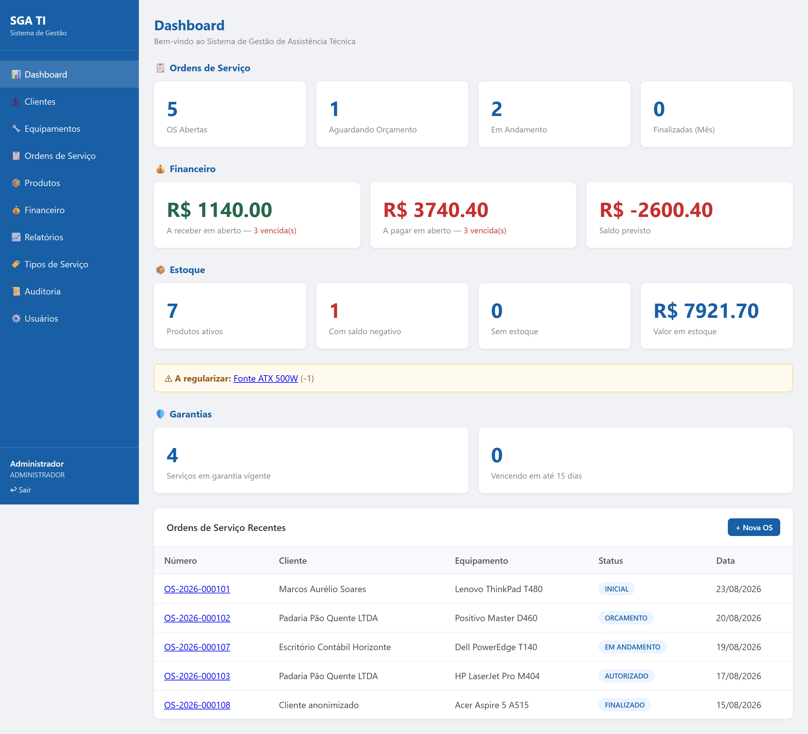

### O menu lateral

O menu à esquerda mostra **apenas o que o seu perfil pode acessar**. Se um colega
tem um item que você não tem, é porque o perfil dele é outro.

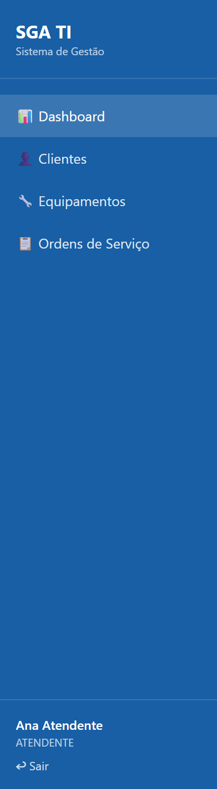

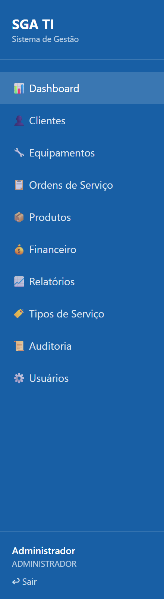

### No celular

Em telas pequenas o menu lateral vira uma barra no topo, recolhida. Toque em
**☰** para abrir e de novo para fechar. As tabelas largas rolam para o lado
dentro da própria caixa, sem empurrar a página.


### Os seis perfis

| Perfil | O que faz |
|---|---|
| **Atendente** | Recebe o cliente: cadastros, abertura de OS, resposta do cliente ao orçamento |
| **Vendedor** | Lança o orçamento e as peças na OS |
| **Técnico** | Executa: muda status, registra serviços e garantia |
| **Compras** | Cadastra produtos e movimenta o estoque |
| **Financeiro** | Contas a pagar e a receber |
| **Administrador** | Tudo, mais usuários, relatórios, auditoria e o **faturamento** |

### Sair

Use **↩ Sair** no rodapé do menu. A sessão expira sozinha após 8 horas.

Se aparecer a tela **Formulário expirado**, a ação não foi executada: a página
estava aberta desde antes de a sessão ser renovada. Volte, recarregue a página
e repita a operação.

---

## 2. O fluxo completo de um atendimento

Esta seção segue **um conserto do início ao fim**, mostrando quem faz o quê. Se
você vai ler só uma parte deste manual, leia esta.

```
  Cliente chega
        ↓
  [ATENDENTE]  cadastra cliente e equipamento, abre a OS      → status INICIAL
        ↓
  [VENDEDOR]   lança o orçamento                              → status ORCAMENTO
        ↓
  Cliente responde
        ↓
  [ATENDENTE]  registra a aprovação                           → status AUTORIZADO
   ou          registra a recusa                              → status CANCELADO
        ↓
  [TECNICO]    registra o primeiro serviço                    → status EM_ANDAMENTO
  [VENDEDOR]   lança as peças usadas                          (baixa o estoque)
        ↓
  [ADMIN]      fatura e encerra                               → status FINALIZADO
                                                               (gera conta a receber)
        ↓
  [FINANCEIRO] dá baixa quando o cliente paga
        ↓
  [ADMIN]      acompanha pelos relatórios
```

### Os seis status da OS

| Status | O que significa | Quem move para o próximo |
|---|---|---|
| `INICIAL` | Equipamento recebido, ainda sem orçamento | Vendedor |
| `ORCAMENTO` | Orçamento lançado, aguardando o cliente | Atendente ou Vendedor |
| `AUTORIZADO` | Cliente aprovou, pode começar | Técnico |
| `EM_ANDAMENTO` | Já tem serviço registrado | Administrador |
| `FINALIZADO` | Serviço concluído e faturado | — |
| `CANCELADO` | Cliente recusou ou desistiu | — |

> **Por que encerrar é coisa da gerência.** Encerrar a OS **gera a conta a
> receber** — ou seja, encerrar é faturar. O técnico consegue mudar o status da
> OS, mas não para `FINALIZADO`: se tentar, o sistema avisa que o encerramento
> depende da liberação da gerência.

---

## 3. Manual do Atendente

Você é a porta de entrada. Seu menu tem **Clientes**, **Equipamentos** e
**Ordens de Serviço**.

### 3.1 Cadastrar um cliente

**Clientes → + Novo Cliente**

Obrigatórios: **nome** e **CPF/CNPJ**. O resto ajuda depois — telefone e celular
são como você avisa que o conserto ficou pronto.

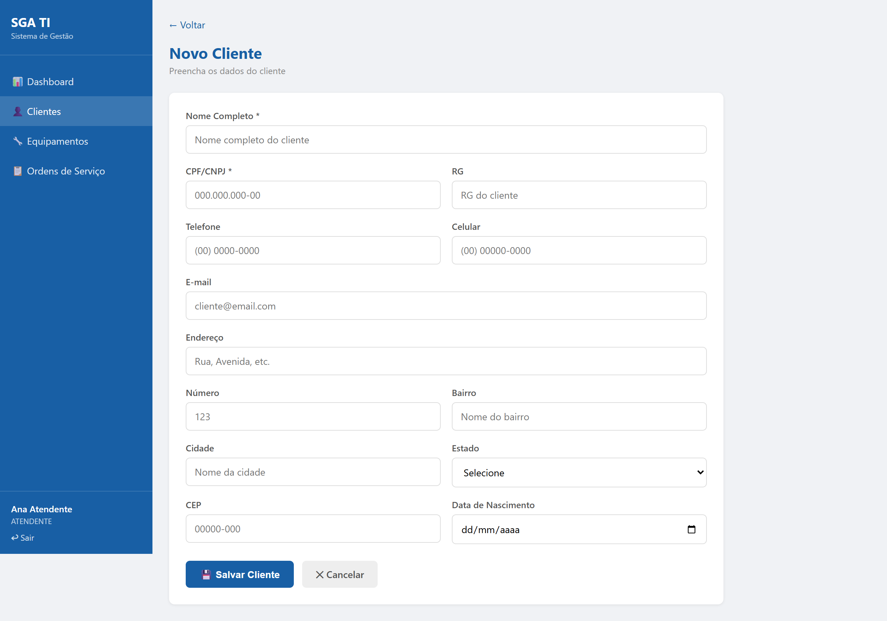

> O CPF/CNPJ **não se repete**. Se o sistema recusar, o cliente provavelmente já
> está cadastrado: procure antes de criar outro.

### 3.2 Cadastrar o equipamento

**Equipamentos → + Novo Equipamento**

| Campo | Observação |
|---|---|
| Cliente | De quem é a máquina |
| Tipo | Notebook, desktop, impressora, servidor, celular ou outro |
| Marca e modelo | Como está na etiqueta |
| Número de série | Opcional, mas é o que distingue dois aparelhos iguais |
| Defeito | O defeito **do cadastro** — a descrição geral do aparelho |

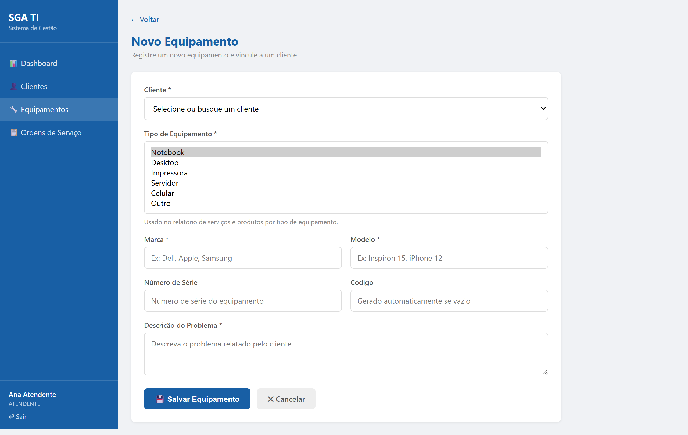

> **O tipo importa.** É por ele que a gerência descobre se a oficina conserta
> mais notebook ou mais impressora. "Outro" funciona, mas não ajuda ninguém.

### 3.3 Abrir a ordem de serviço

**Ordens de Serviço → + Nova OS**

Escolha o cliente; a lista de equipamentos se ajusta sozinha aos aparelhos dele.

No **defeito relatado**, escreva o que o cliente falou, com as palavras dele.
Não confunda com o defeito do cadastro: aqui é o problema **desta visita**.

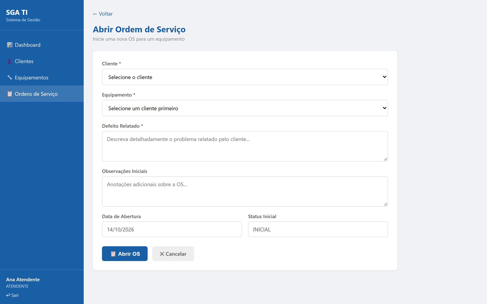

O sistema gera o **número da OS** automaticamente. **Anote e entregue ao
cliente** — é com ele que o cliente acompanha o conserto pela internet, sem
precisar ligar.

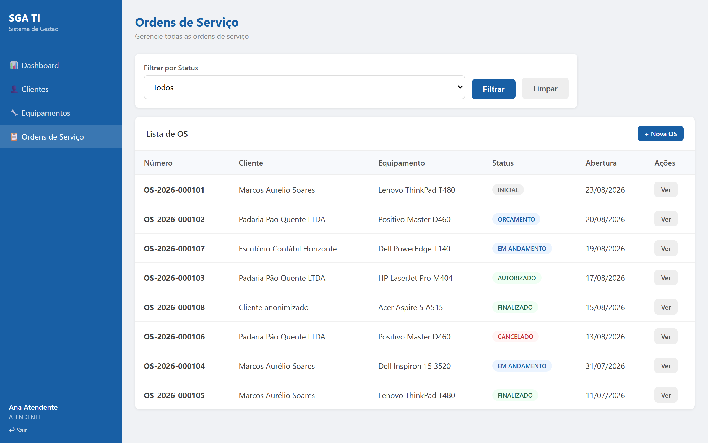

### 3.4 Registrar a resposta do cliente

Quando o cliente retornar sobre o orçamento, abra a OS e use:

- **✅ Aprovar orçamento** → a OS vai para `AUTORIZADO` e o técnico pode começar;
- **❌ Rejeitar orçamento** → a OS vai para `CANCELADO`.

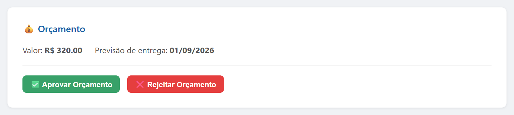

> Só dá para aprovar uma OS que **tenha orçamento lançado**. Se os botões não
> aparecem, o vendedor ainda não lançou o valor.

### 3.5 Consultar o histórico do equipamento

Em **Equipamentos**, botão **🕓 Histórico**.

Mostra tudo que já foi feito naquela máquina, em todas as OS, com a situação da
garantia de cada serviço.

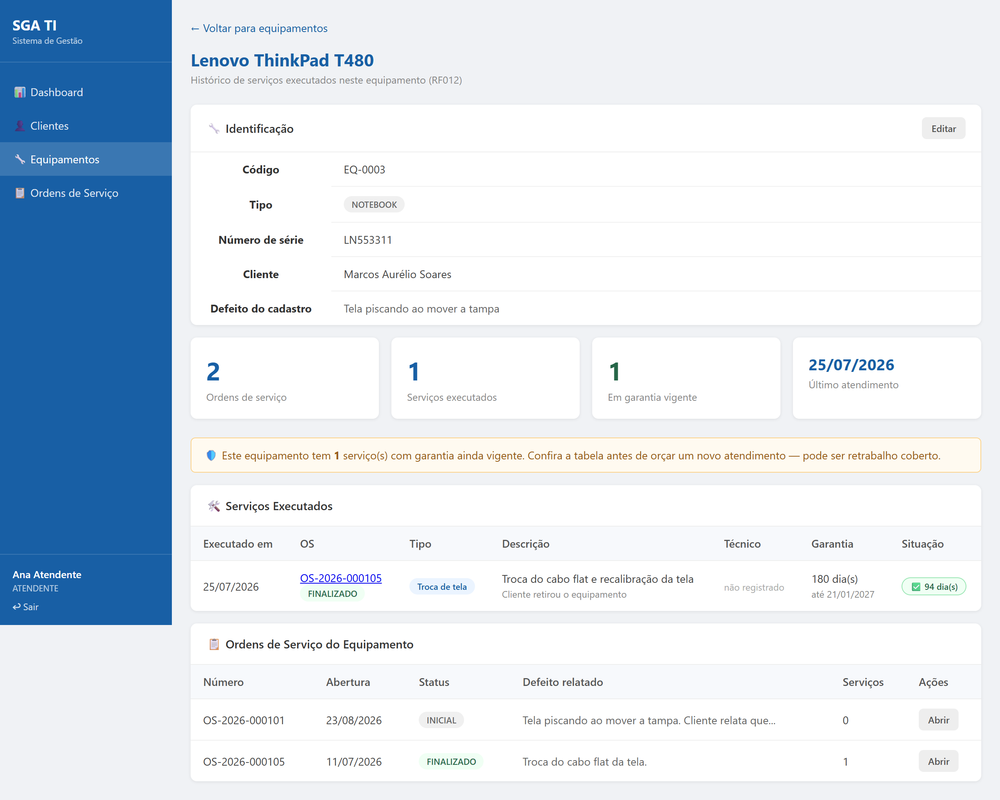

> **Use isto antes de abrir OS de retorno.** Se o cliente volta com o mesmo
> problema e o serviço ainda está na garantia, é retrabalho coberto — não se
> cobra de novo.

---

## 4. Manual do Vendedor

Seu menu tem **Ordens de Serviço** e **Produtos** (em consulta).

### 4.1 Lançar o orçamento

Abra a OS e preencha o quadro de orçamento:

| Campo | Observação |
|---|---|
| Valor | Obrigatório, maior que zero. Aceita vírgula |
| Previsão de entrega | Opcional, mas é o que o cliente pergunta |
| Observações | O que compõe o valor |

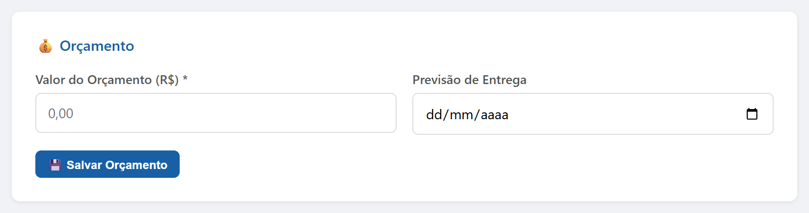

A OS passa para `ORCAMENTO` e o atendente pode registrar a resposta do cliente.

> **O valor do orçamento já inclui as peças.** É o valor combinado com o cliente.
> Ao encerrar, a conta a receber usa esse valor — não soma as peças de novo.

> Depois que a OS sai de `ORCAMENTO`, o formulário some e vira um resumo. Isso é
> proposital: orçamento aprovado não se altera por baixo do cliente.

### 4.2 Lançar peças na OS

No detalhe da OS, bloco **📦 Produtos Utilizados**: escolha o produto, a
quantidade e confirme.

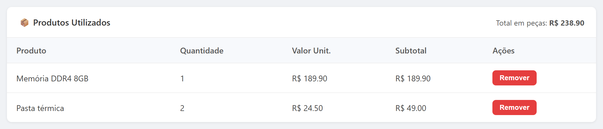

O estoque **baixa automaticamente**. Se não houver saldo, o sistema **permite e
avisa** — o saldo fica negativo e aparece na lista "a regularizar" do setor de
Compras.

> Isso é decisão de projeto, não falha: travar a saída pararia o atendimento no
> balcão enquanto alguém procura o cadastro da peça.

O **valor unitário** é copiado do produto no momento do lançamento. Se o preço
de tabela mudar depois, esta OS continua valendo o que foi cobrado.

---

## 5. Manual do Técnico

Seu menu tem **Ordens de Serviço**. Você também alcança o histórico do
equipamento pelo link dentro da OS.

### 5.1 Antes de mexer: consulte o histórico

No detalhe da OS, bloco do equipamento, clique em
**🕓 Ver histórico de serviços deste equipamento**.

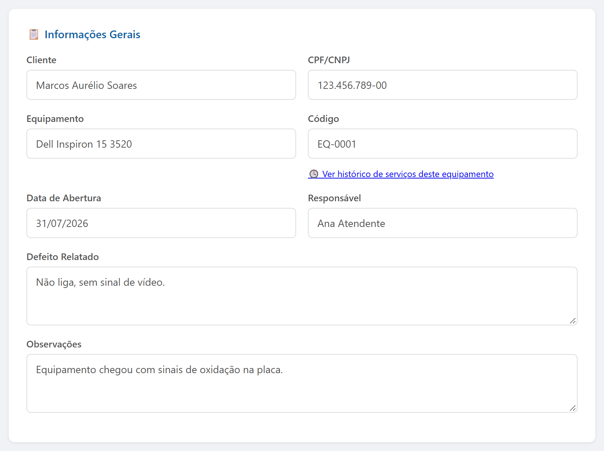

Se já houve serviço com garantia vigente, você está diante de um retrabalho.

### 5.2 Registrar um serviço executado

No detalhe da OS, bloco **🛠️ Serviços Executados**:

| Campo | Observação |
|---|---|
| Tipo de serviço | Escolha do catálogo. É o que permite à gerência saber o que a oficina mais faz |
| Descrição | Obrigatória, mínimo 5 caracteres. O seu relato do caso |
| Garantia (dias) | Opcional, de 0 a 3650. Em branco ou 0 = sem garantia |
| Observações | Opcional |

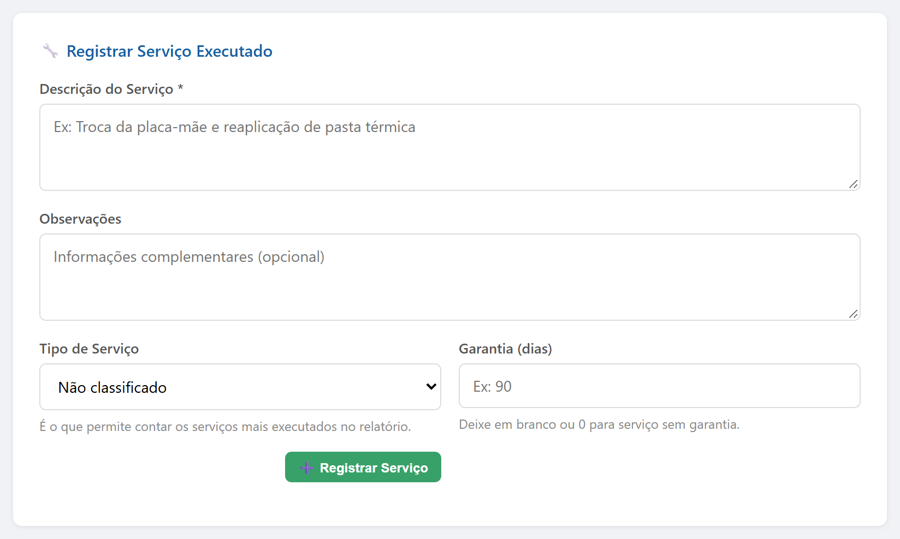

> **Ao registrar o primeiro serviço numa OS `AUTORIZADO`, ela vira
> `EM_ANDAMENTO` sozinha.** Você não precisa mudar o status à mão.

> Só dá para registrar serviço em OS `AUTORIZADO` ou `EM ANDAMENTO`. Antes da
> aprovação do cliente, não.

### 5.3 A garantia

Você informa **quantos dias**; o sistema calcula o resto e mostra a situação:

| Marca | Significado |
|---|---|
| ✅ **73 dia(s)** | Em garantia, com os dias restantes |
| ⌛ **Vencida** | O prazo acabou |
| **Sem garantia** | Serviço registrado sem prazo |

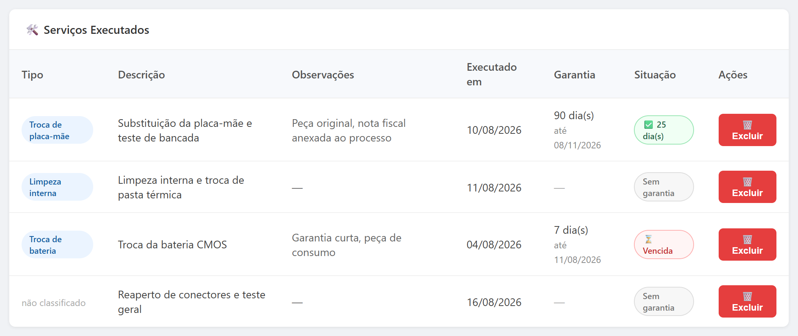

> A data-fim **não é digitada nem armazenada**: sai de `data de execução + dias`.
> Por isso nunca fica desatualizada.

### 5.4 Mudar o status

No detalhe da OS, bloco de status.

> **Você não encerra a OS.** Encerrar gera o faturamento e é da gerência. Se
> tentar, o sistema avisa. Deixe em `EM_ANDAMENTO` e comunique a gerência quando
> o serviço estiver pronto.

### 5.5 Excluir um serviço lançado por engano

Botão **🗑️ Excluir** na linha do serviço. Não funciona em OS `FINALIZADO` nem
`CANCELADO` — nesse ponto o registro é histórico.

---

## 6. Manual do setor de Compras

Seu menu tem **Produtos**.

### 6.1 Cadastrar um produto

**Produtos → + Novo Produto**: nome, preço de venda, estoque inicial.

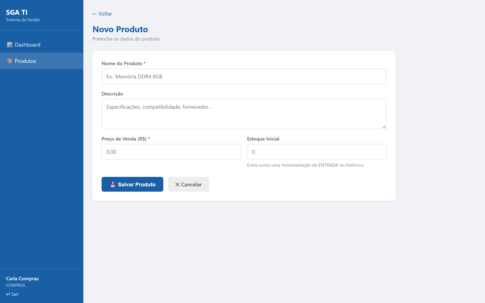

### 6.2 Entrada de estoque

**Produtos → [produto] → Estoque**, formulário **Registrar Movimentação**:

| Tipo | Quando usar |
|---|---|
| **ENTRADA** | Compra, devolução ao estoque |
| **SAÍDA** | Baixa manual, perda, quebra |

Na descrição, registre a nota fiscal e o fornecedor — é o que permite conferir
depois.

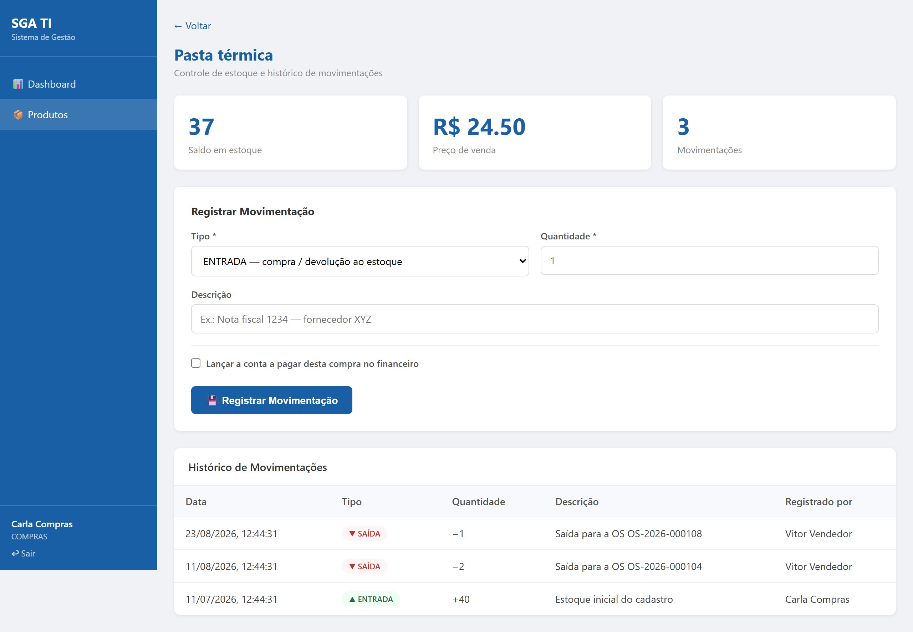

> As saídas por OS **não se lançam aqui**: elas acontecem sozinhas quando o
> vendedor lança a peça na ordem de serviço.

### 6.3 Produtos com saldo negativo

O dashboard traz a lista **"a regularizar"**, com link direto. Saldo negativo
significa que a peça saiu pela OS antes de a entrada ser registrada. **Regularize
com uma ENTRADA.**

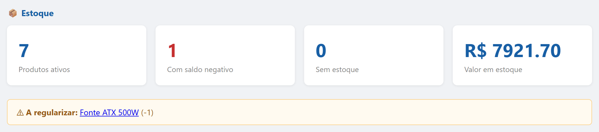

### 6.4 Desativar um produto

Botão **Excluir** na lista. O produto **não é apagado**: fica inativo, some das
listas e para de ser oferecido nas OS. O histórico continua. Para trazer de
volta, use **Mostrar inativos** e **Reativar**.

---

## 7. Manual do Financeiro

Seu menu tem **Financeiro**.

### 7.1 O painel

Mostra contas a pagar e a receber, com totais em aberto, vencidos e o saldo
previsto.

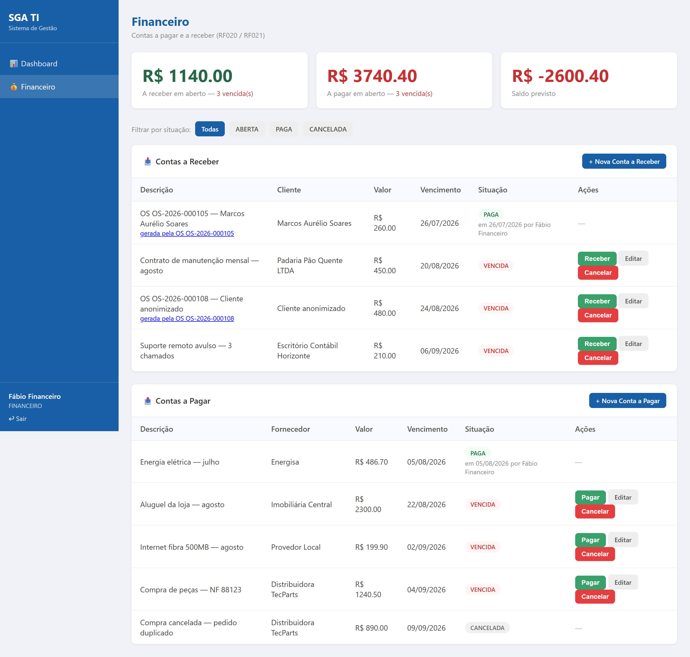

### 7.2 Lançar uma conta

**+ Nova conta a pagar** ou **+ Nova conta a receber**: descrição, valor,
vencimento. Na conta a pagar, o fornecedor; na conta a receber, o cliente.

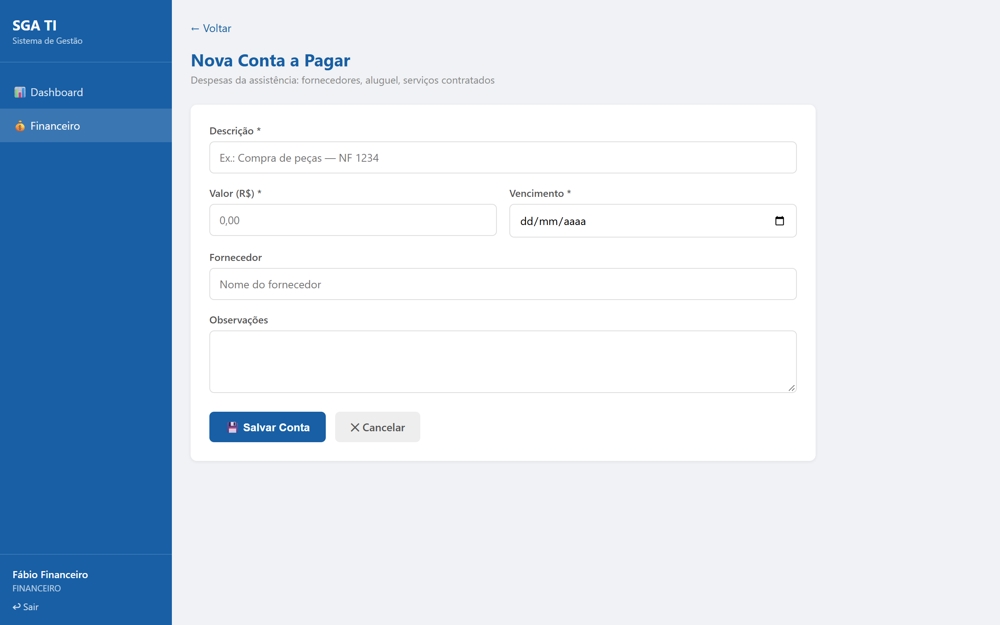

### 7.3 A conta que aparece sozinha

Quando a gerência encerra uma OS, **o sistema cria a conta a receber
automaticamente**, na mesma operação. É proposital: encerrar OS sem lançar o
valor a receber é o furo de caixa mais comum do controle manual.

O valor é:

- o **valor do orçamento**, quando houve orçamento aprovado;
- a **soma das peças**, quando a OS foi encerrada sem orçamento.

> Não é orçamento + peças. O orçamento combinado com o cliente **já inclui as
> peças**; somar os dois cobraria a peça duas vezes.

### 7.4 Quitar e cancelar

- **Quitar** — registra o pagamento, com data e quem deu baixa;
- **Cancelar** — a conta deixa de contar no saldo, mas continua visível.

Nenhuma conta é apagada.

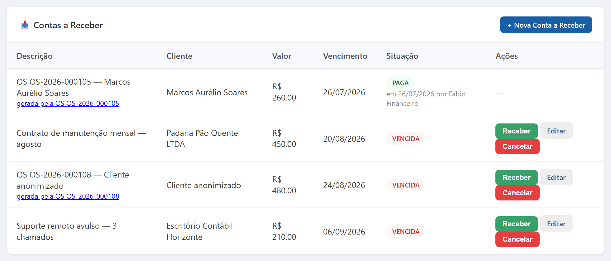

---

## 8. Manual do Administrador

Você vê tudo, mais **Tipos de Serviço**, **Relatórios**, **Auditoria** e
**Usuários**.

### 8.1 Criar usuários

**Usuários → + Novo Usuário**: nome, login, senha e **perfil**.

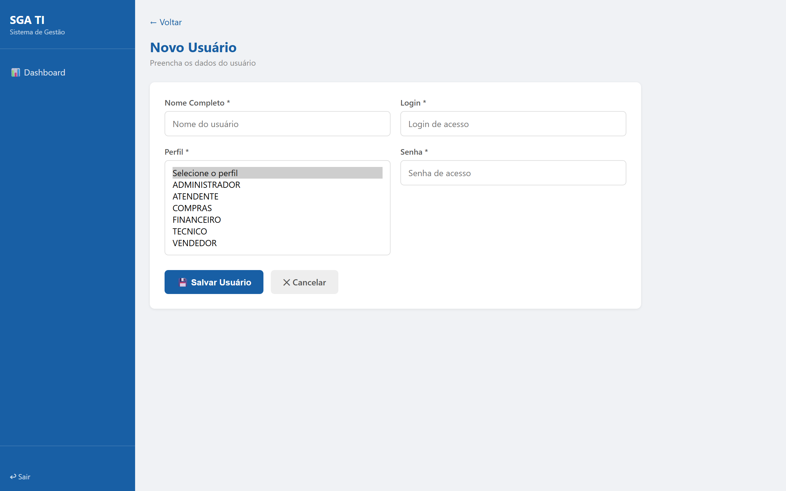

> **Troque a senha do `admin` no primeiro acesso.** A senha padrão está escrita
> na documentação do projeto — é pública.

### 8.2 Catálogo de tipos de serviço

**Tipos de Serviço**. É o que dá consistência ao relatório: sem catálogo, "troca
de tela", "Troca da tela" e "substituição de tela" viram três serviços
diferentes.

Tipo desativado some da escolha do técnico, mas **o histórico não muda**.

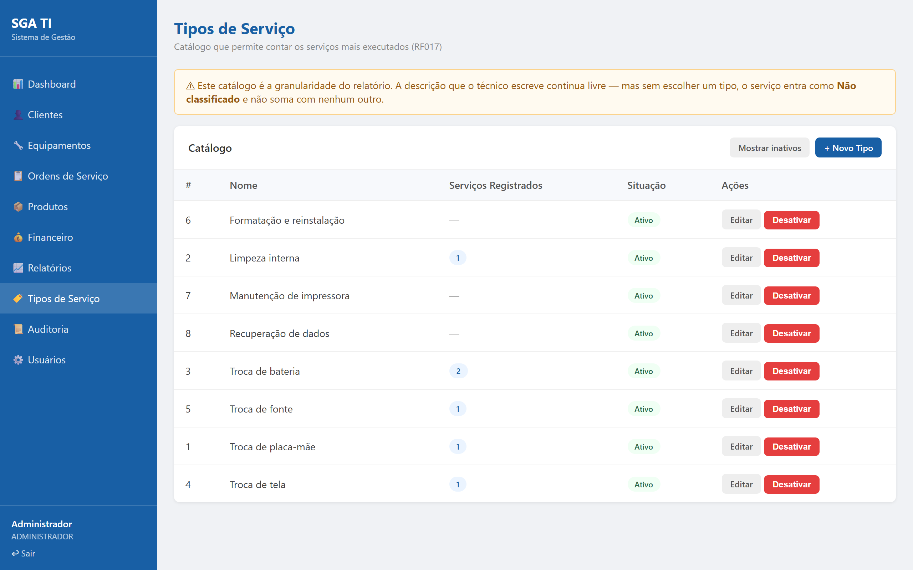

### 8.3 Faturar e encerrar a OS

No detalhe da OS, botão **Faturar e encerrar**.

Isso faz três coisas de uma vez, e **ou acontece tudo, ou nada**:

1. muda o status para `FINALIZADO`;
2. grava a data de fechamento;
3. **gera a conta a receber**.

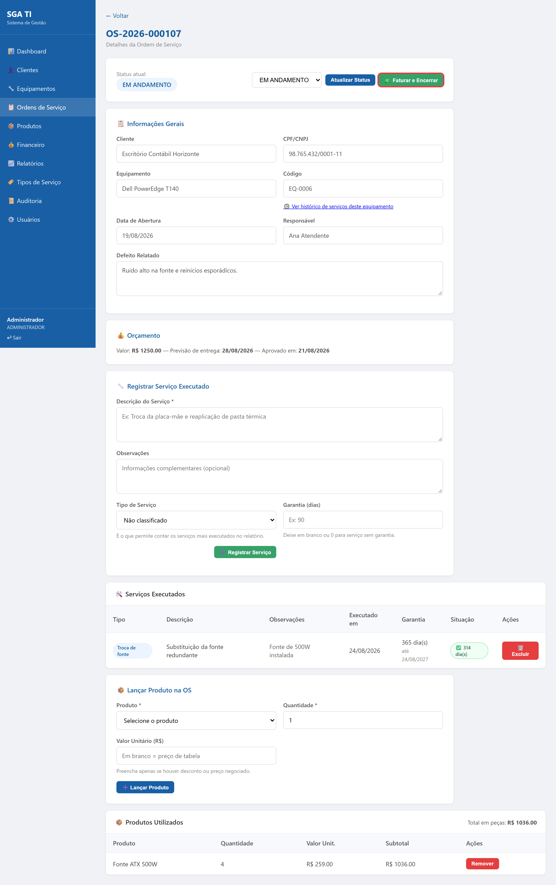
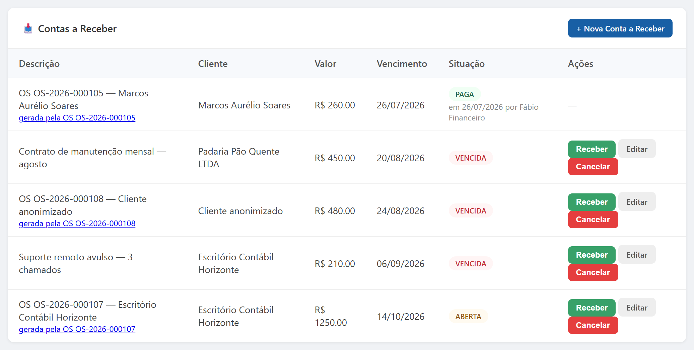

### 8.4 Relatórios

**Relatórios**. Cinco relatórios, um período compartilhado (padrão: últimos 30
dias):

| Relatório | Responde |
|---|---|
| 👤 Maiores clientes | Quem mais trouxe receita |
| 📦 Produtos mais vendidos | Quais peças giram |
| 🛠️ Serviços mais executados | O que a oficina mais faz |
| 💻 Por tipo de equipamento | Quais aparelhos dão mais trabalho |
| 🗺️ Demanda por região | De quais cidades vêm os clientes e o faturamento |

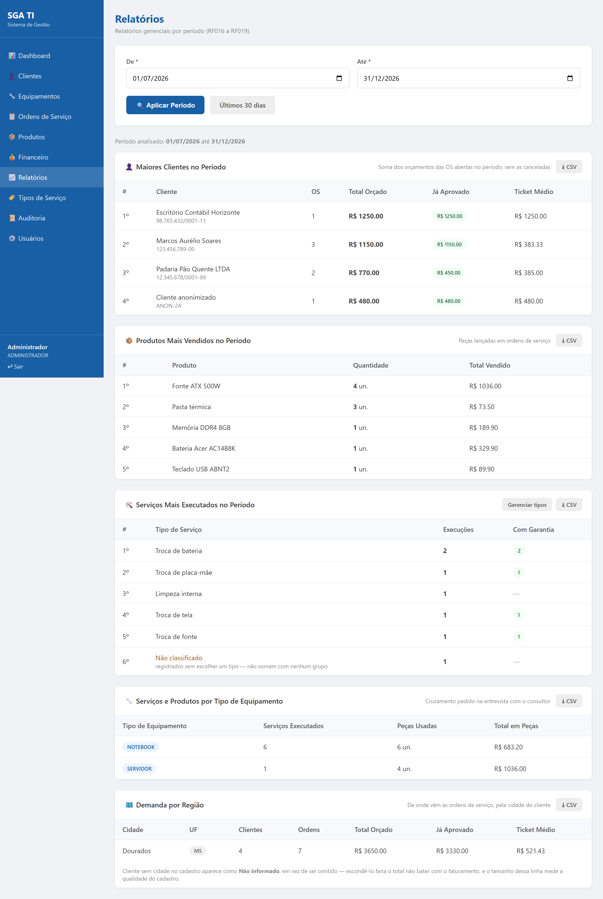

Botão **⭳ CSV** em cada um, respeitando o período da tela. O arquivo abre no
Excel em português com acento e valores corretos.

`[PRINT: CSV exportado, aberto no Excel — capturar manualmente, depende do Excel instalado]`

> **"Não classificado"** nos serviços são os registros feitos antes do catálogo
> existir, ou sem tipo escolhido. Aparecem de propósito — escondê-los falsearia o
> relatório.

### 8.5 Auditoria

**Auditoria**. Registra **quem alterou o quê, quando e de qual IP**, em todo o
sistema.

A tela mostra só **o que mudou**, no formato `antes → depois`:

```
ALTERACAO  Cliente  #26   nome: Cliente da Auditoria → Cliente da Auditoria LTDA
                          cidade: Dourados → Campo Grande
```

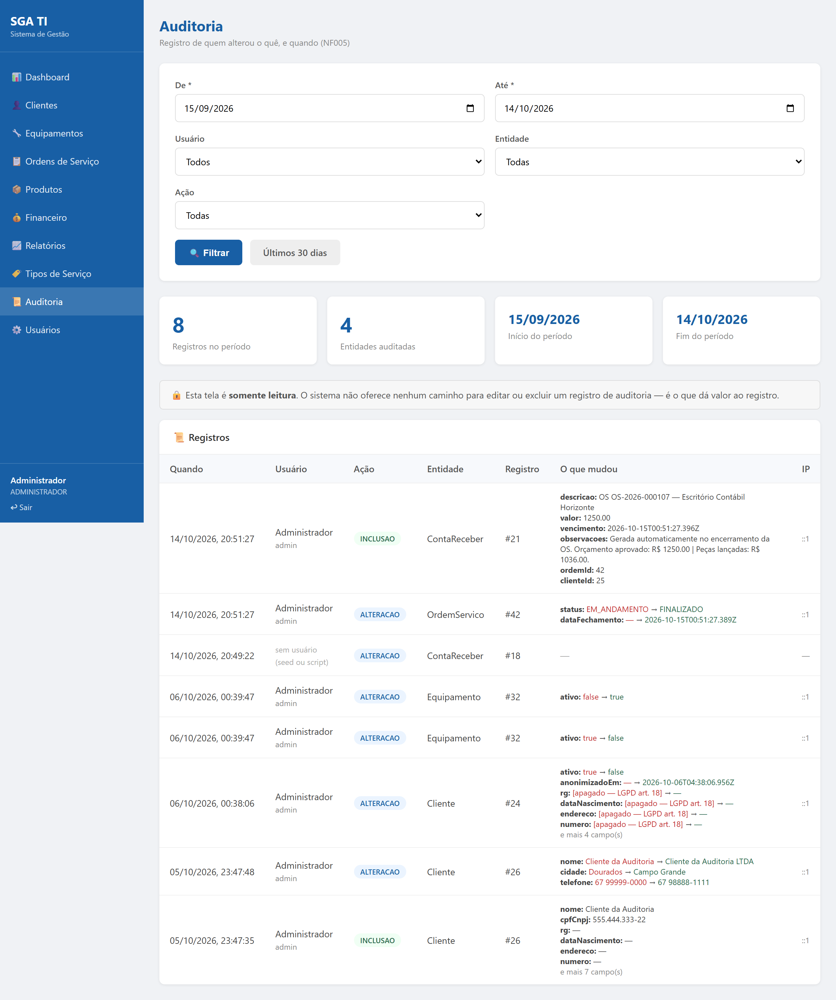

Filtros de período, usuário, entidade e ação.

> **Esta tela é somente leitura.** O sistema não oferece nenhum caminho para
> editar ou apagar um registro de auditoria — é o que dá valor ao registro.
> Senhas nunca aparecem no log, nem o hash.

### 8.6 Dados pessoais — pedido de exclusão (LGPD)

Se um cliente exigir a exclusão dos dados dele, use **🔒 Anonimizar** na lista de
clientes.

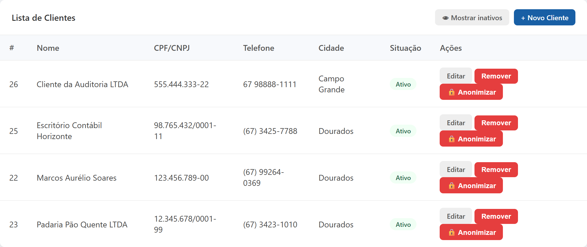

> A confirmação que aparece ao clicar é a janela nativa do navegador — por isso
> não está na captura. Ela repete o que será apagado e o que será preservado, e
> avisa que a operação não pode ser desfeita.

O que acontece: nome, CPF/CNPJ, RG, data de nascimento, endereço e contatos são
**apagados** — do cadastro, da descrição das contas a receber geradas no
faturamento e do registro de auditoria. As ordens de serviço, equipamentos,
serviços e contas são **preservados** — são registro fiscal; só perdem o dado
pessoal.

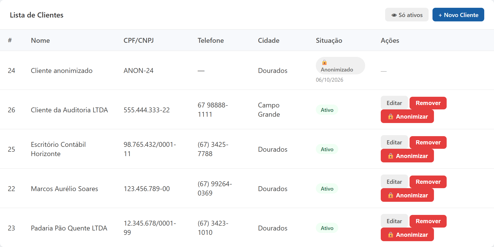

> **A operação não pode ser desfeita.** Confirme o pedido antes.
> Cidade e estado permanecem: não identificam ninguém sozinhos e sustentam a
> análise por região.

### 8.7 Desativar equipamento

Em **Equipamentos**, botão **Desativar**: o aparelho some da lista e não entra em
OS nova, mas o histórico fica. **Reativar** traz de volta.

---

## 9. Para o cliente — consulta pública

> Esta seção pode ser impressa e entregue ao cliente junto com o comprovante.

Acompanhe seu conserto pela internet, **sem login e sem precisar ligar**.

1. Acesse o endereço da assistência e clique em **Consultar OS**;
2. Informe o **número da ordem de serviço** que está no seu comprovante;
3. Veja a situação.

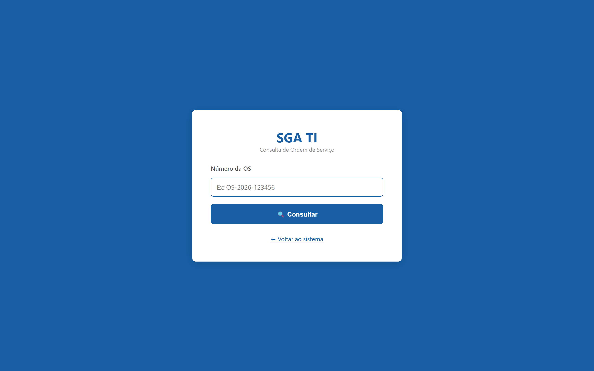

O que aparece:

| Informação | |
|---|---|
| Situação do conserto | Em orçamento, autorizado, em andamento, finalizado |
| Equipamento | Marca e modelo |
| Defeito relatado | |
| Valor do orçamento | Quando já lançado |
| Previsão de entrega | Quando informada |
| Serviços executados | O que foi feito |
| **Garantia** | Até quando cada serviço está coberto |

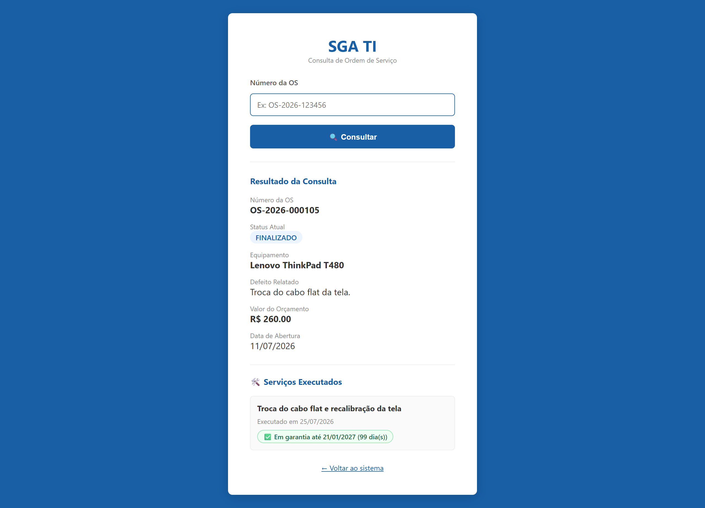

> **Guarde o número da OS.** É só com ele que a consulta funciona — e é o que
> protege seus dados de quem não deveria vê-los.

Se aparecer **"Muitas consultas sem sucesso"**, foram vários números errados
seguidos a partir da mesma conexão. Aguarde 15 minutos, confira o número no
comprovante e tente de novo.

---

## 10. Perguntas frequentes

**Não consigo ver um menu que meu colega vê.**
Os perfis são diferentes. Fale com o administrador se precisar de acesso.

**O sistema diz que não posso registrar serviço nesta OS.**
O cliente ainda não aprovou o orçamento. A OS precisa estar `AUTORIZADO` ou
`EM ANDAMENTO`.

**Tentei encerrar a OS e o sistema recusou.**
Encerrar gera o faturamento e é da gerência. Peça ao administrador.

**O estoque ficou negativo.**
A peça saiu pela OS antes de a entrada ser registrada. O setor de Compras
regulariza com uma ENTRADA. O sistema avisa, não trava.

**Cadastrei um cliente duas vezes.**
O CPF/CNPJ é único, então o sistema recusa a duplicata. Se já aconteceu, remova
um dos dois — a remoção é lógica, o histórico fica.

**Apaguei um cliente por engano.**
Nada é apagado de verdade. Use **Mostrar inativos** para encontrá-lo.
*Exceção:* a **anonimização** é irreversível.

**O relatório veio vazio.**
Confira o período. O padrão são os últimos 30 dias, e OS canceladas não entram no
relatório de clientes.

**O CSV abriu tudo numa coluna só no Excel.**
Não deveria — o arquivo usa ponto e vírgula justamente por causa do Excel em
português. Se acontecer, avise a equipe do sistema.

**Esqueci minha senha.**
Só o administrador redefine. Não há recuperação automática.

**No celular, o menu sumiu.**
Ele fica recolhido para dar espaço ao conteúdo. Toque em **☰** no topo da tela.

**O sistema demorou para abrir.**
No ambiente gratuito, o servidor hiberna após 15 minutos sem uso e leva de 30 a
60 segundos para voltar. A partir daí fica normal.
