# Apêndice B — Manual do Usuário do SGA TI

**Sistema de Gestão para Assistência Técnica em Tecnologia da Informação**
Versão 3 · Novembro de 2026 — no modelo de manual da 6ª Etapa do TCC

---

## 1. INTRODUÇÃO

As assistências técnicas de informática de pequeno e médio porte costumam
controlar o atendimento em papel e planilhas: o cadastro do cliente, o
equipamento deixado na loja, o orçamento, as peças usadas, a garantia de cada
serviço e o valor a receber ficam espalhados. Com isso, a garantia se perde, o
estoque fica sem controle e não é raro um conserto ser encerrado sem que o valor
seja lançado no caixa. O cliente, por sua vez, só sabe do andamento do conserto
se ligar para a loja.

O SGA TI foi desenvolvido a partir do processo real da Lelo Informática, em
Dourados (MS), para reunir esse ciclo num único sistema web: do cadastro do
cliente à entrega do equipamento, com acesso separado por perfil de usuário e
acompanhamento pelo próprio cliente, pela internet.

O presente manual tem como finalidade orientar os usuários na utilização das
funcionalidades do software SGA TI, facilitando assim o acesso e o entendimento
do sistema. Este descreve os procedimentos necessários para a utilização,
detalhando cada atividade e seus respectivos passos.

## 2. FUNCIONALIDADES

- Cadastrar clientes, equipamentos e usuários
- Abrir ordens de serviço, com cadastro rápido de cliente e equipamento na própria tela
- Acompanhar a ordem de serviço por seis status, do recebimento ao encerramento
- Lançar o orçamento e registrar a aprovação ou a recusa do cliente
- Registrar os serviços executados, com o técnico responsável e a garantia de cada um
- Lançar as peças usadas na ordem de serviço, com baixa automática do estoque
- Consultar o histórico de serviços de cada equipamento
- Cadastrar produtos e registrar entradas e saídas de estoque
- Faturar e encerrar a ordem de serviço, gerando a conta a receber
- Desbloquear com senha uma ordem de serviço já concluída
- Controlar contas a pagar e a receber
- Gerar relatórios gerenciais e exportá-los em CSV
- Consultar o registro de auditoria das alterações
- Anonimizar os dados pessoais de um cliente, a pedido dele (LGPD)
- Registrar a saída para entrega e compartilhar a localização do entregador
- Acompanhar a entrega no mapa, pelo administrador e pelo cliente
- Consultar o andamento do conserto pela internet, sem login (cliente)

## 3. BENEFÍCIOS ESPERADOS

- Fim do encerramento de conserto sem o lançamento do valor a receber: encerrar
  a ordem de serviço gera a conta automaticamente
- Controle da garantia de cada serviço, calculada pelo sistema
- Estoque atualizado a cada peça lançada na ordem de serviço
- Menos ligações para a loja: o cliente acompanha o conserto e a entrega pela
  internet
- Cada funcionário vê apenas o que é da sua função
- Relatórios para decidir com base em dados: maiores clientes, serviços mais
  executados, produtos mais vendidos, tipos de equipamento e regiões atendidas
- Registro de quem alterou o quê e quando, e atendimento à LGPD

## 4. COMO ACESSAR O SISTEMA?

O SGA TI é acessado pelo navegador (Chrome, Edge, Firefox), no computador ou no
celular, digitando o endereço do sistema informado pela assistência. Não é
preciso instalar nada.

Não há cadastro público de usuários. Cada funcionário recebe do **administrador**
um **login** e uma **senha**, ligados a um dos sete perfis do sistema:

| Perfil | O que faz |
|---|---|
| **Atendente** | Recebe o cliente: cadastros, abertura de OS e resposta do cliente ao orçamento |
| **Vendedor** | Lança o orçamento e as peças na OS |
| **Técnico** | Executa o conserto: muda o status e registra os serviços e a garantia |
| **Compras** | Cadastra produtos e movimenta o estoque |
| **Financeiro** | Contas a pagar e a receber |
| **Entregador** | Leva as OS finalizadas até o cliente, pelo celular |
| **Administrador** | Tudo, mais usuários, relatórios, auditoria e o faturamento |

O administrador recebe a conta especial criada na implantação do sistema e, a
partir dela, cria os demais usuários.

Para entrar, abra o endereço do sistema, informe o **login** e a **senha** e
clique em **Entrar**.

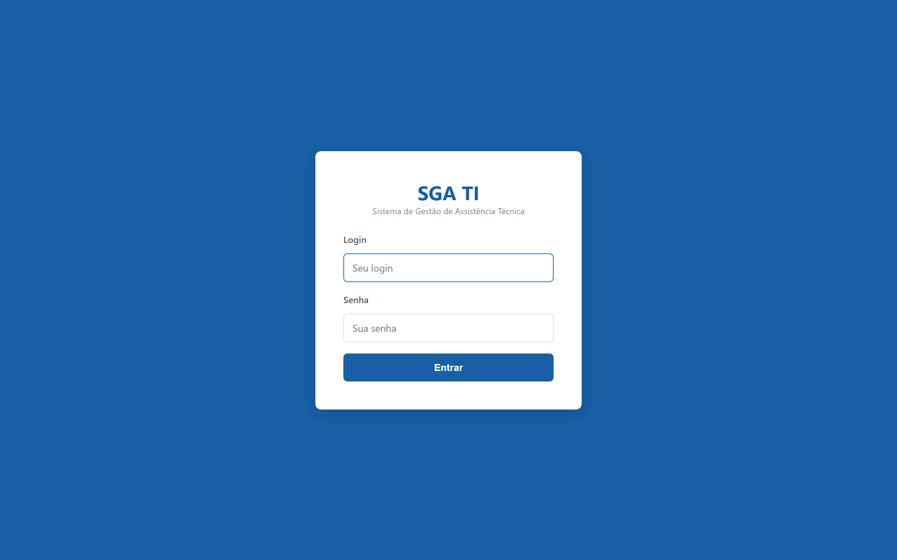

Caso o sistema não reconheça o login, ou a senha não confira, ele informa que as
**"Credenciais inválidas."**, sem dizer qual dos dois está errado — assim ninguém
descobre quais logins existem por tentativa.

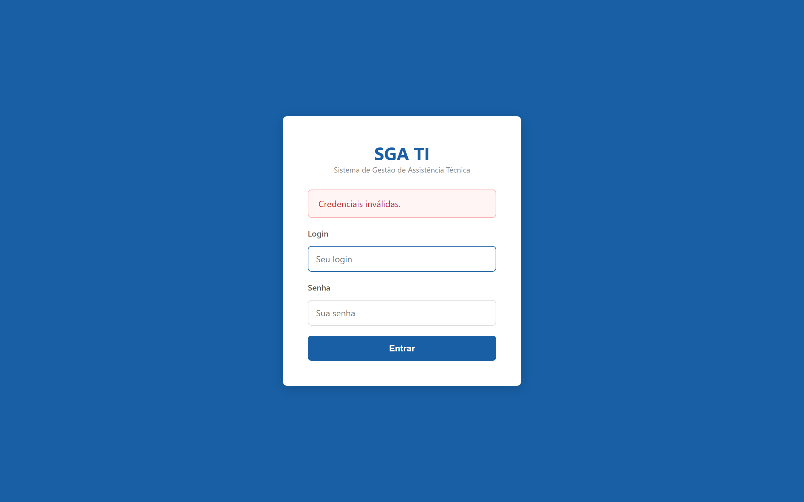

Depois de 10 tentativas erradas em 15 minutos, a partir da mesma conexão, o
sistema bloqueia novas tentativas e mostra **"Muitas tentativas de login. Aguarde
15 minutos e tente novamente."**.

A senha de login é definida pelo administrador ao criar o usuário. O sistema
exige apenas que ela seja informada; não há regra obrigatória de letras, números,
símbolos ou quantidade de caracteres. Recomenda-se uma senha de pelo menos 8
caracteres, misturando letras e números. A senha é guardada criptografada e
ninguém a vê, nem o administrador; se for esquecida, o administrador define uma
nova, porque não há recuperação automática.

## 5. APÓS REALIZAR O LOGIN (USUÁRIO)

O usuário que realizar o login dentro do sistema terá a visualização de um
**menu lateral**, à esquerda, e do **Dashboard**, a tela inicial. O menu mostra
**apenas o que o perfil do usuário pode acessar**; no rodapé dele ficam o nome, o
perfil e o botão **Sair**. O entregador é a exceção: ao entrar, vai direto para a
tela de entregas.

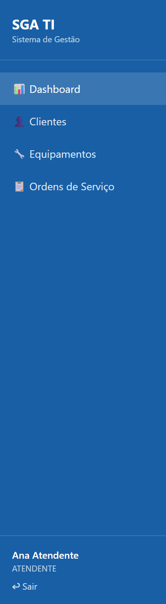

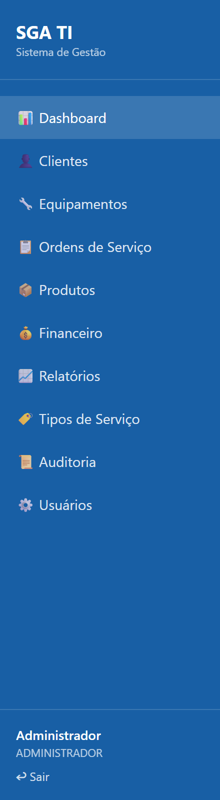

A seguir, cada funcionalidade, com o perfil que a utiliza e a tela correspondente.

### 5.1 Dashboard

*Todos os perfis, exceto o entregador.*

O Dashboard mostra blocos diferentes conforme o perfil: o técnico vê as
garantias, o financeiro vê o caixa, o setor de compras vê o estoque, e o
administrador vê todos, além das últimas ordens de serviço.

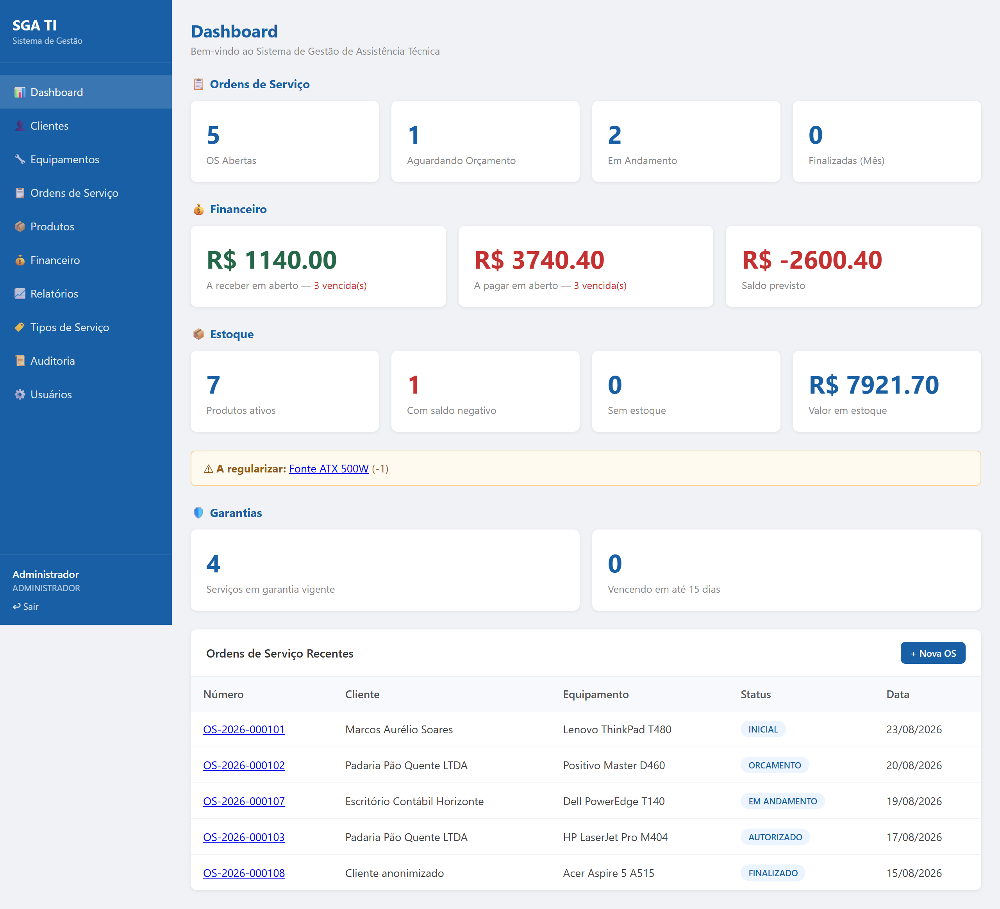

### 5.2 Cadastro de clientes

*Atendente e administrador.* Menu **Clientes → + Novo Cliente**.

Informe o nome e o CPF/CNPJ, que são obrigatórios, e os demais dados: RG, data
de nascimento, endereço, cidade, estado, CEP, telefone, celular e e-mail. O
telefone é o que permite avisar o cliente e acompanhar a entrega. O CPF/CNPJ não
se repete: se o sistema recusar, o cliente provavelmente já está cadastrado.

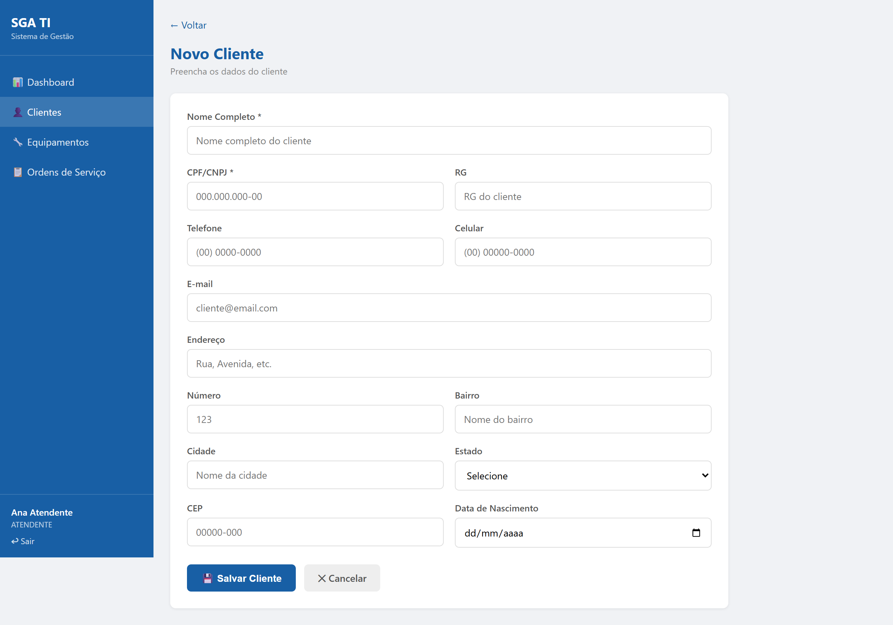

Na lista de clientes é possível editar e, para o administrador, desativar um
cliente. Nada é apagado de verdade: o cliente desativado some da
lista, mas o histórico continua, e **Mostrar inativos** o traz de volta.

### 5.3 Cadastro de equipamentos

*Atendente e administrador.* Menu **Equipamentos → + Novo Equipamento**.

Escolha o cliente dono do equipamento e informe o tipo (notebook, desktop,
impressora, servidor, celular ou outro), a marca, o modelo, o número de série e
o defeito informado. O tipo é usado no relatório que mostra quais aparelhos dão
mais trabalho.

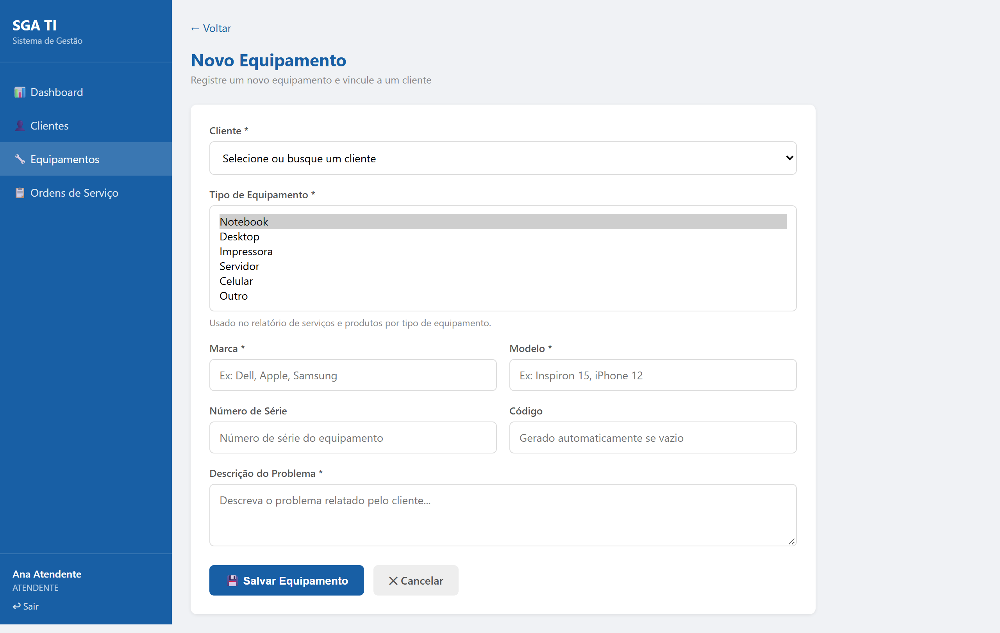

### 5.4 Abertura de ordem de serviço

*Atendente e administrador.* Menu **Ordens de Serviço → + Nova OS**.

Escolha o cliente; a lista de equipamentos mostra só os aparelhos dele. No
**defeito relatado**, escreva o que o cliente contou sobre esta visita. O sistema
gera o **número da OS** automaticamente: entregue esse número ao cliente, porque
é com ele que o cliente acompanha o conserto pela internet.

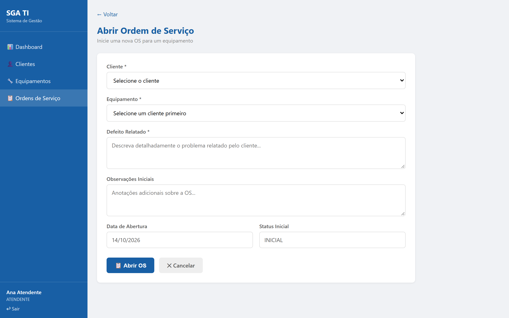

Se o cliente ou o equipamento ainda não estiverem cadastrados, não é preciso sair
da tela. Os botões **+ Novo Cliente** e **+ Novo Equipamento**, ao lado dos campos,
abrem um cadastro rápido; ao salvar, o item já aparece escolhido na OS.

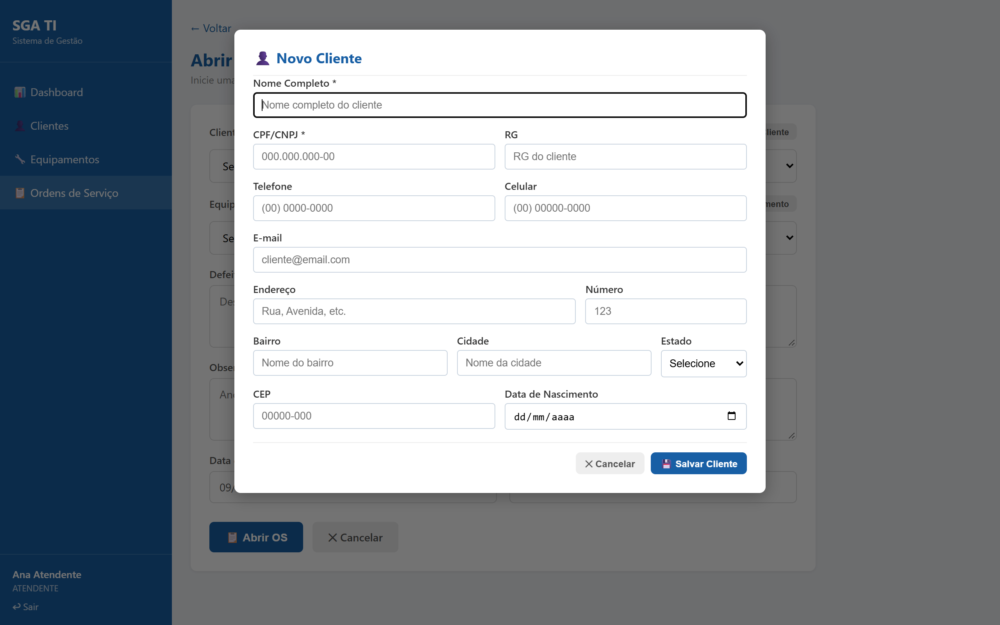

No cadastro rápido de equipamento também é possível anotar as condições em que o
aparelho chegou e os acessórios deixados; essas informações vão para as
observações da OS.

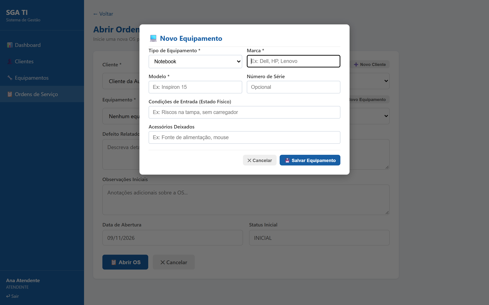

### 5.5 Acompanhamento das ordens de serviço

*Atendente, técnico, vendedor e administrador.* Menu **Ordens de Serviço**.

A lista mostra todas as OS com o status em cores. Cada OS passa por seis status:

| Status | O que significa | Quem move para o próximo |
|---|---|---|
| Inicial | Equipamento recebido, ainda sem orçamento | Vendedor |
| Orçamento | Orçamento lançado, aguardando o cliente | Atendente ou vendedor |
| Autorizado | Cliente aprovou; o conserto pode começar | Técnico |
| Em andamento | Já há serviço registrado | Administrador |
| Concluído | Serviço finalizado e faturado | — |
| Cancelado | Cliente recusou ou desistiu | — |

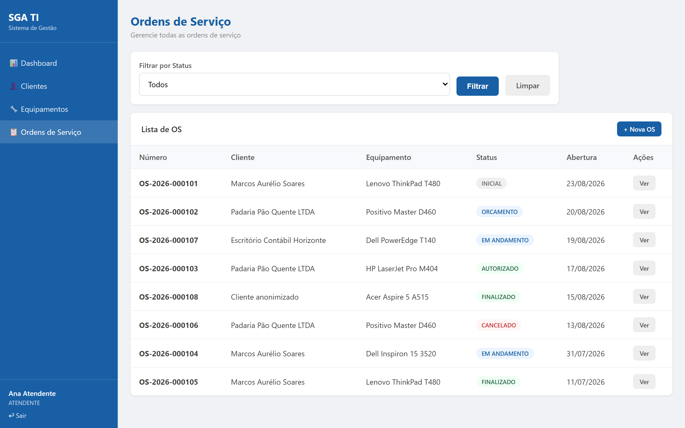

### 5.6 Orçamento

*Vendedor (lançar) e atendente (resposta do cliente).*

No detalhe da OS, o vendedor informa o **valor** (obrigatório), a **previsão de
entrega** e as observações. A OS passa para **Orçamento**. O valor combinado já
inclui as peças.

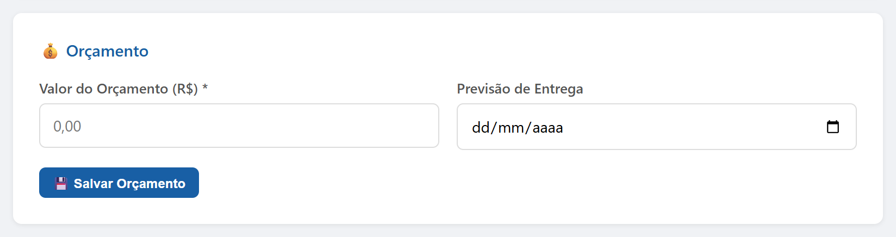

Quando o cliente responder, o atendente abre a OS e clica em **✅ Aprovar
orçamento** (a OS vai para **Autorizado**) ou **❌ Rejeitar orçamento** (vai para
**Cancelado**). A data da aprovação é registrada.

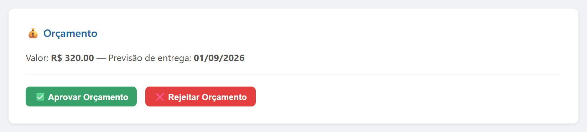

### 5.7 Serviços executados e garantia

*Técnico e administrador.*

No detalhe da OS, bloco **🛠️ Serviços Executados**, escolha o tipo de serviço,
descreva o que foi feito (mínimo de 5 caracteres) e informe a garantia em dias
(em branco ou 0, sem garantia). O técnico de cada serviço é quem está logado ao
registrá-lo. Ao registrar o primeiro serviço numa OS **Autorizado**, ela passa
sozinha para **Em andamento**.

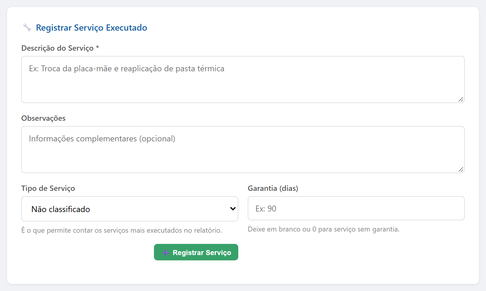

O sistema calcula até quando vai a garantia de cada serviço e mostra a situação:
em garantia (com os dias restantes), vencida ou sem garantia.

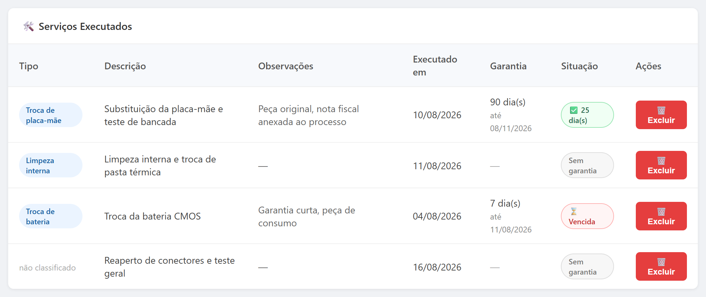

### 5.8 Peças usadas na OS

*Vendedor e administrador.*

No bloco **📦 Produtos Utilizados**, escolha o produto e a quantidade e, se
quiser, o serviço em que a peça foi usada. O estoque baixa automaticamente. Se
não houver saldo, o sistema permite e avisa: o saldo fica negativo para o setor
de compras regularizar, sem travar o atendimento.

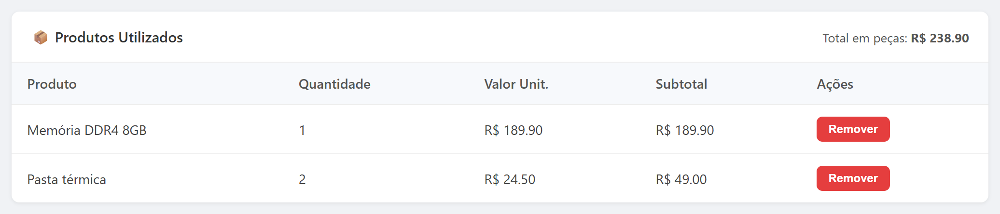

### 5.9 Histórico do equipamento

*Atendente, técnico e administrador.* Botão **🕓 Histórico** na lista de
equipamentos, ou o link dentro da OS.

Mostra todos os serviços já feitos naquele aparelho, em todas as OS, com o
técnico e a situação da garantia. Antes de abrir uma OS de retorno, confira: se o
serviço ainda está na garantia, não se cobra de novo.

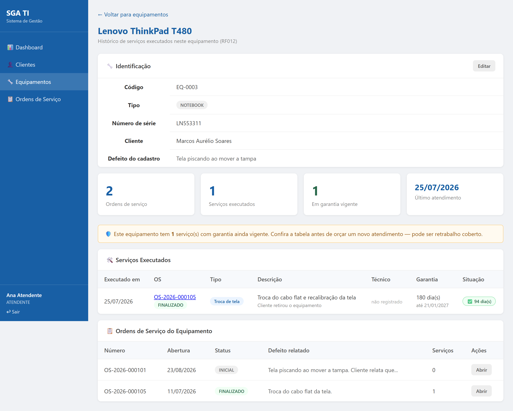

### 5.10 Faturar e encerrar a OS

*Somente administrador.*

No detalhe da OS em andamento, o botão **Faturar e encerrar** faz três coisas de
uma vez: muda o status para **Concluído**, grava a data de fechamento e **gera a
conta a receber** no financeiro. Ou acontece tudo, ou nada. O técnico não
encerra a OS, porque encerrar é faturar.

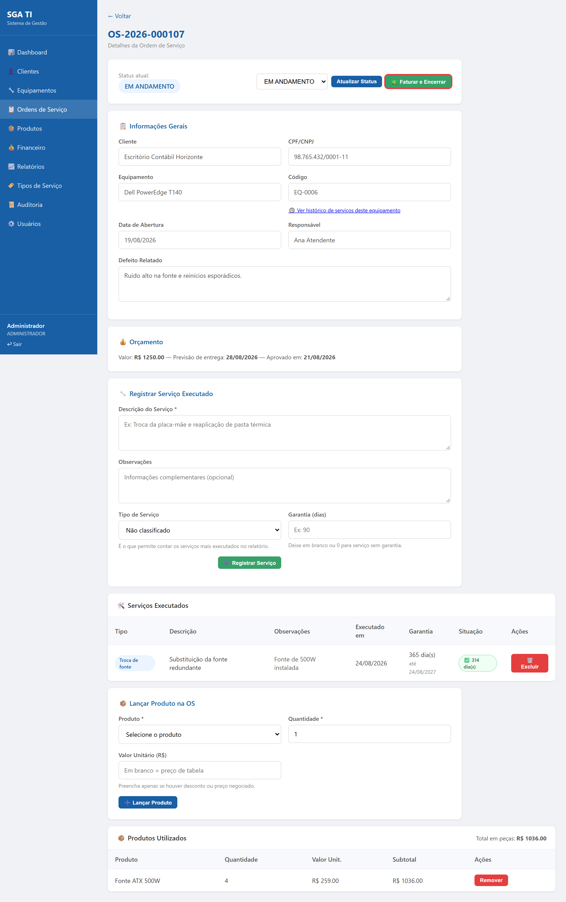

### 5.11 Desbloquear uma OS concluída

*Usuários que alteram o status da OS.*

A OS concluída fica bloqueada contra alterações acidentais: o status e os campos
aparecem desabilitados, com o aviso **"Ordem de Serviço Concluída"**. Se for
preciso corrigir algo, clique em **🔒 Desbloquear com Senha** e confirme a sua
própria senha de login.

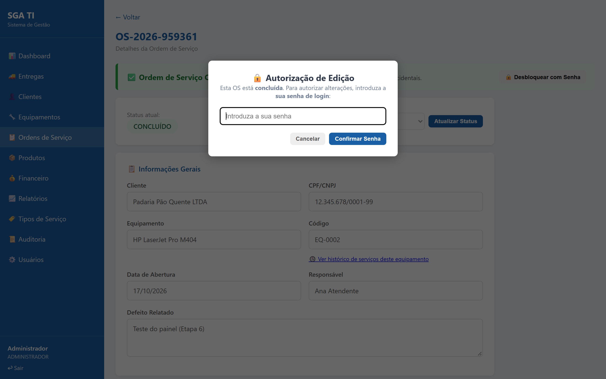

Com a senha certa, o aviso muda para **"Edição desbloqueada"** e os campos são
liberados; com a senha errada, aparece **"Senha incorreta."**. O desbloqueio vale
até a página ser recarregada. Ao mudar o status, escolha o novo valor com
atenção: a lista começa em **Inicial**.

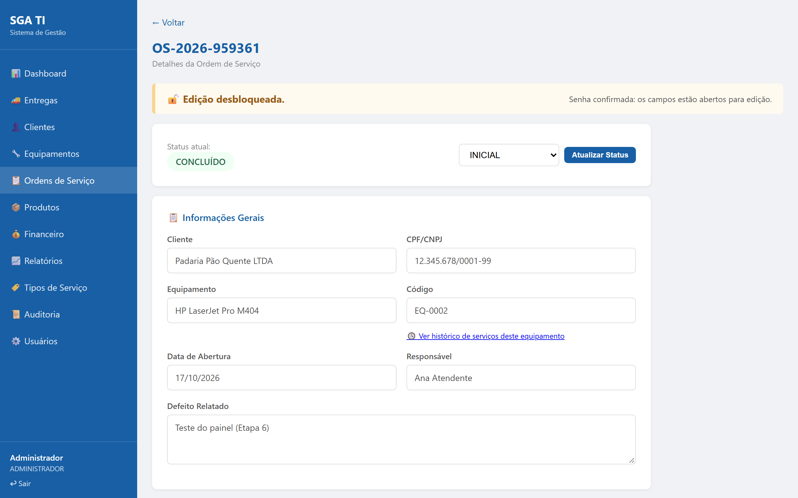

### 5.12 Produtos e estoque

*Compras (e administrador).* Menu **Produtos**.

Em **+ Novo Produto**, informe o nome, o preço de venda e o estoque inicial.

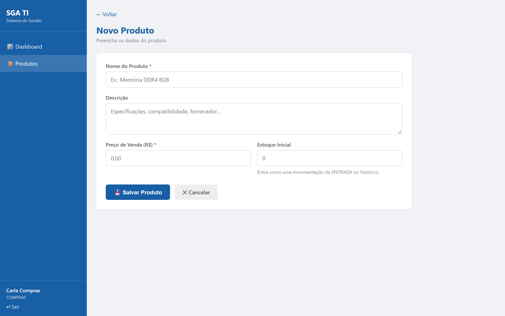

Na tela **Estoque** de cada produto, registre as **entradas** (compra,
devolução) e as **saídas** manuais (perda, quebra), anotando a nota fiscal e o
fornecedor na descrição. As saídas por OS acontecem sozinhas quando a peça é
lançada na ordem de serviço.

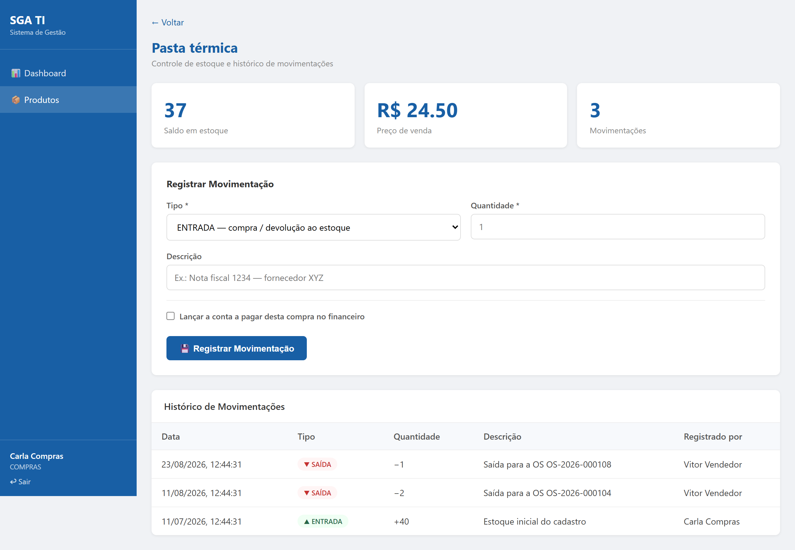

### 5.13 Financeiro

*Financeiro e administrador.* Menu **Financeiro**.

O painel mostra as contas a pagar e a receber, com os totais em aberto, os
vencidos e o saldo previsto. Em **+ Nova conta a pagar** ou **+ Nova conta a
receber**, informe a descrição, o valor e o vencimento. As contas das OS
faturadas aparecem sozinhas.

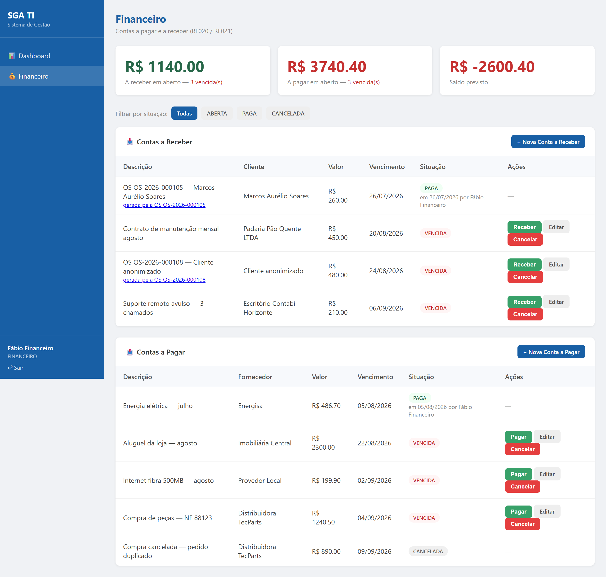

**Quitar** registra o pagamento, com a data e quem deu baixa; **Cancelar** tira a
conta do saldo, mas ela continua visível. Nenhuma conta é apagada.

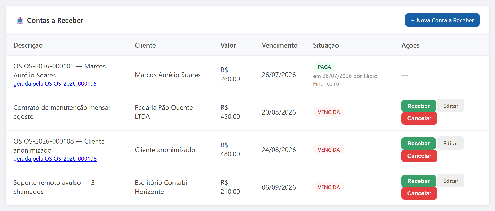

### 5.14 Relatórios

*Somente administrador.* Menu **Relatórios**.

São cinco relatórios para o mesmo período (padrão: últimos 30 dias): maiores
clientes, produtos mais vendidos, serviços mais executados, serviços e produtos
por tipo de equipamento e demanda por região. Cada um tem o botão **⭳ CSV**, que
gera um arquivo para abrir no Excel.

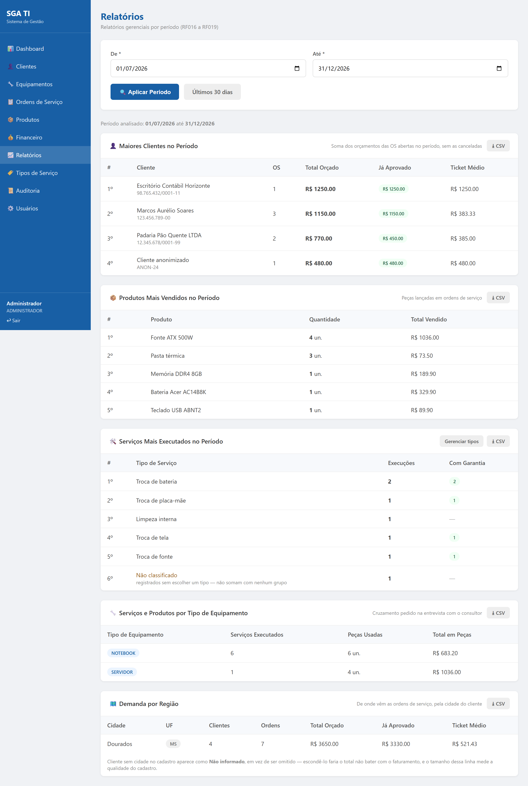

### 5.15 Tipos de serviço

*Somente administrador.* Menu **Tipos de Serviço**.

É o catálogo que o técnico usa ao registrar um serviço. Ele mantém o relatório
consistente: sem catálogo, "troca de tela" e "substituição de tela" contariam
como serviços diferentes. Um tipo desativado deixa de ser oferecido, mas o
histórico não muda.

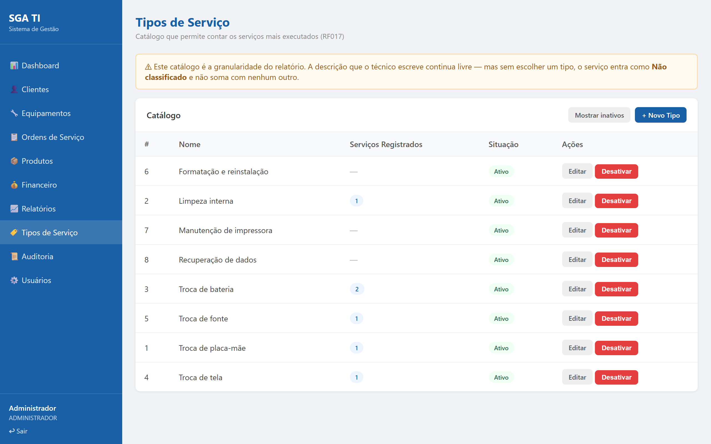

### 5.16 Usuários

*Somente administrador.* Menu **Usuários → + Novo Usuário**.

Informe o nome, o login, a senha e o perfil. O perfil define o menu e o que o
usuário pode fazer. No primeiro acesso, troque a senha do usuário administrador
padrão.

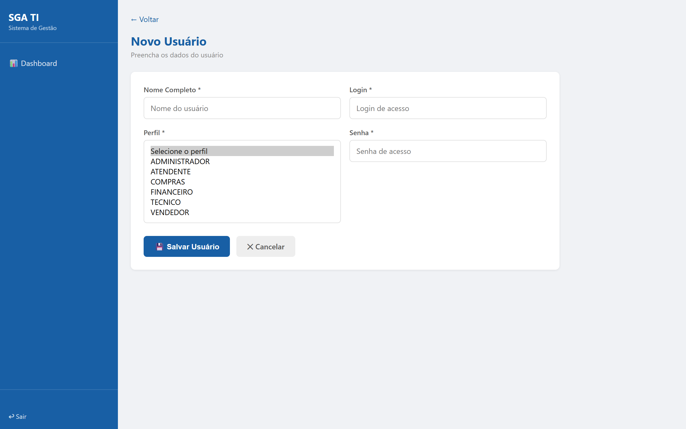

### 5.17 Auditoria

*Somente administrador.* Menu **Auditoria**.

Registra automaticamente quem alterou o quê, quando e de qual endereço, em todo o
sistema, mostrando o valor antes e depois de cada alteração. Há filtros por
período, usuário, entidade e ação. A tela é somente leitura e as senhas nunca
aparecem.

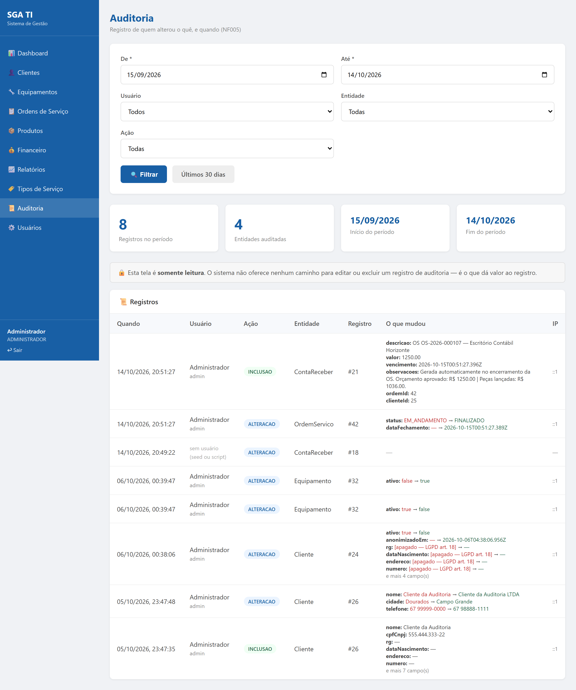

### 5.18 Anonimização de cliente (LGPD)

*Somente administrador.* Botão **🔒 Anonimizar** na lista de clientes.

Atende o pedido do cliente de exclusão dos dados pessoais. Nome, CPF/CNPJ, RG,
data de nascimento, endereço e contatos são apagados do cadastro, das contas e
da auditoria, e a localização da casa sai das entregas. As ordens de serviço, os
serviços e as contas continuam, sem o dado pessoal. A operação não pode ser
desfeita, e não é feita enquanto houver entrega em andamento para o cliente.

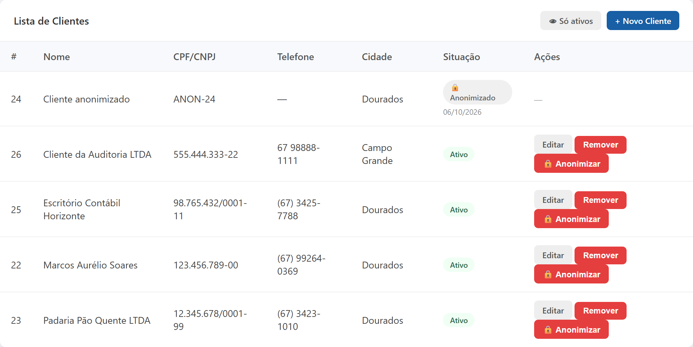

### 5.19 Entregas: tela do entregador

*Entregador, pelo celular, com a localização permitida.*

A tela lista as OS concluídas que ainda não foram entregues. Marque as que vai
levar, na ordem em que vai passar, e toque em **🚚 Iniciar saída**. Só existe uma
saída em rota por vez.

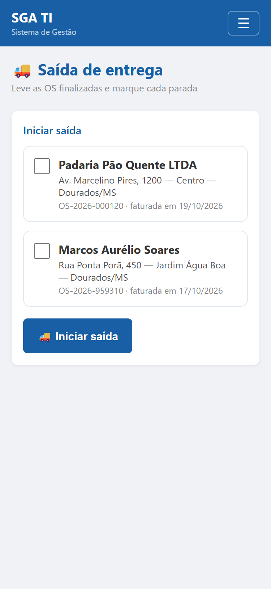

Durante a saída, o celular envia a localização a cada 10 segundos e cada parada
vira um cartão com os botões **🧭 Navegar** (abre o mapa do celular), **📲 Avisar
no WhatsApp** (mensagem pronta com o link de acompanhamento), **✅ Entregue** e
**Não entregue** (com o motivo obrigatório). Mantenha a tela acesa: com ela
bloqueada, o envio da localização para. Ao final, toque em **🏁 Encerrar saída**.

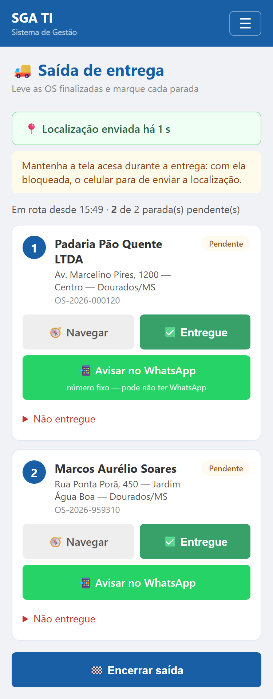

### 5.20 Painel de entregas

*Somente administrador.* Menu **Entregas**.

Mostra no mapa o entregador e as paradas, com a cor do status de cada uma, a
tabela das paradas e o histórico das saídas. O mapa se atualiza sozinho a cada
10 segundos. O administrador também pode cancelar uma saída. Trinta dias depois
do fim da saída, o trajeto e a localização das casas são apagados.

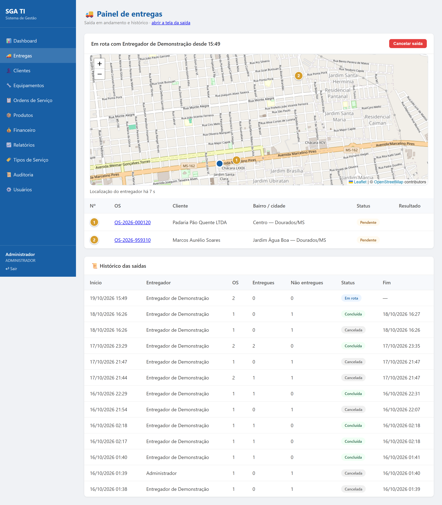

### 5.21 Consulta pública pelo cliente

*Cliente, sem login.* Endereço do sistema seguido de **/consulta**.

O cliente informa o número da OS que está no comprovante e vê a situação do
conserto, o equipamento, o orçamento, a previsão de entrega, os serviços
executados e até quando vai a garantia.

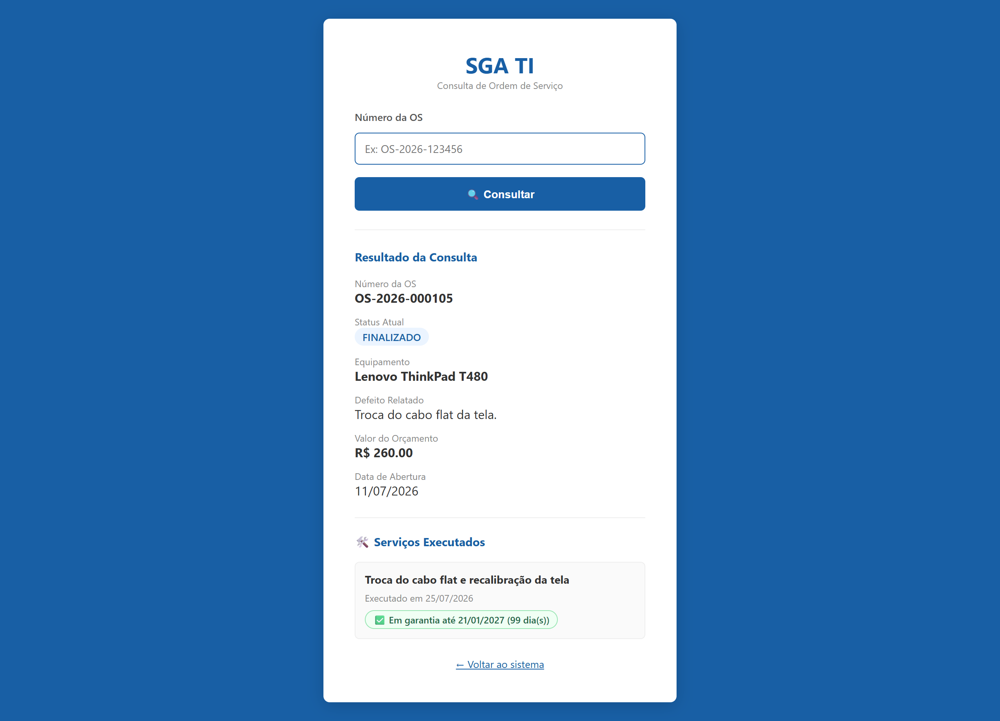

Quando o equipamento sai para entrega, a consulta pede os **4 últimos dígitos do
telefone** do cadastro e, com eles, mostra o mapa com o entregador a caminho.
Depois da entrega, aparecem o dia e a hora em que ela aconteceu.

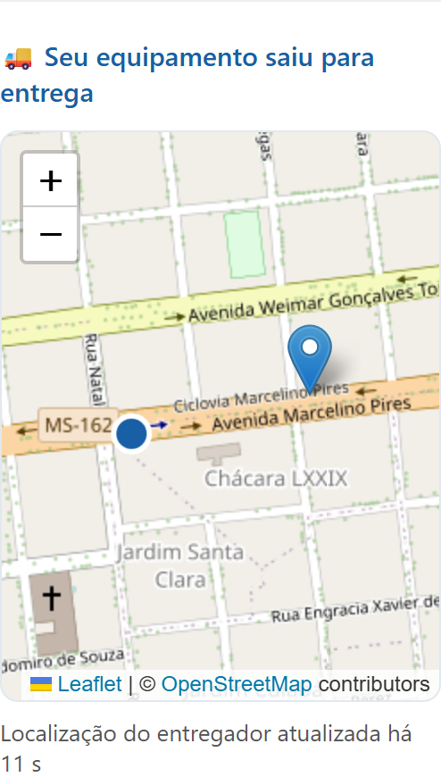

### 5.22 Uso no celular

*Todos os perfis.*

Em telas pequenas, o menu lateral vira uma barra no topo, recolhida; toque em
**☰** para abrir e de novo para fechar. As tabelas largas rolam para o lado
dentro da própria caixa.

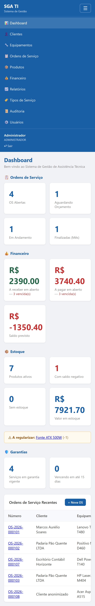

## 6. LOGOUT DO SISTEMA

Para realizar o logout do sistema, basta clicar em **↩ Sair**, no rodapé do menu
lateral, abaixo do nome e do perfil do usuário. No celular, abra o menu pelo
**☰** para ver o botão. O sistema volta para a tela de login.

Por segurança, a sessão também se encerra sozinha depois de 8 horas. Se aparecer
a tela **"Formulário expirado"**, a última ação não foi executada: recarregue a
página, entre de novo se for preciso e repita a operação.
