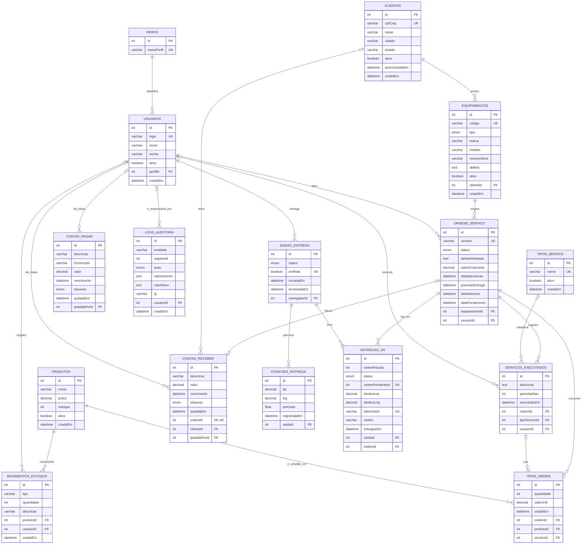

# DER — Diagrama Entidade-Relacionamento

**Sistema:** SGA TI — Sistema de Gerenciamento de Assistência Técnica
**Origem:** gerado a partir de `prisma/schema.prisma` e das oito migrations em
`prisma/migrations/`, na `main` consolidada
**Data:** 05/10/2026 — atualizado em 15/10/2026 (técnico e peça do serviço) e
16/10/2026 (Módulo 6, entregas)
**SGBD:** MySQL 8 (`provider = "mysql"`)

> `[VALIDAR: confronto com a Figura 4 da monografia.]` O documento acadêmico não
> estava disponível quando este DER foi gerado. A seção 7 lista o que mudou com
> base na descrição do plano de trabalho, mas a comparação lado a lado com a
> figura atual ainda precisa ser feita.

---

## 1. Visão geral

O modelo tem **16 tabelas** e **6 enumerações**, organizadas em seis blocos:

| Bloco | Tabelas | Módulos |
|---|---|---|
| Acesso | `perfis`, `usuarios` | 1 e 4 |
| Atendimento | `clientes`, `equipamentos`, `ordens_servico`, `servicos_executados`, `tipos_servico` | 1, 2, 3 e 5 |
| Estoque | `produtos`, `itens_ordem`, `movimentos_estoque` | 4 |
| Financeiro | `contas_pagar`, `contas_receber` | 4 |
| Rastreabilidade | `logs_auditoria` | NF005 |
| Entregas | `saidas_entrega`, `entregas_os`, `posicoes_entrega` | 6 |

O núcleo do sistema é a trilha **cliente → equipamento → ordem de serviço**. Tudo
o mais pendura nela: os serviços executados e as peças descrevem o que foi feito
na OS, e a conta a receber nasce do encerramento dela.

---

## 2. Diagrama

Para manter a figura legível em A4, o diagrama mostra a **chave primária, as
chaves estrangeiras, as chaves únicas e os atributos que definem cada entidade**.
A listagem completa de campos está na seção 5, uma tabela por entidade.



### 2.1 Figuras exportadas

| Arquivo | Conteúdo | Dimensões |
|---|---|---|
| `docs/der.png` | Diagrama completo, com os atributos | 5092 × 4768 px |
| `docs/der-visao-geral.png` | Só entidades e relacionamentos | 5800 × 2176 px |

As versões anteriores ficam em `docs/der-antigo/`, só para comparação — não
representam o modelo atual:

| Arquivos | Data | Conteúdo |
|---|---|---|
| `der-2026-10-05.png`, `der-visao-geral-2026-10-05.png` | 05/10/2026 | 13 tabelas, 15 relacionamentos |
| `der-2026-10-15.png`, `der-visao-geral-2026-10-15.png` | 15/10/2026 | 13 tabelas, 17 relacionamentos (técnico e peça do serviço) |

Geradas com `@mermaid-js/mermaid-cli` 11 a partir do bloco acima, tema
`neutral`, fundo branco, escala 4 — o mesmo layout e o mesmo estilo das figuras
de 05/10/2026. A largura é a que reproduz as figuras originais: 1289 para o
diagrama completo e 1466 para a visão geral, que é o mesmo bloco sem as listas
de atributos.

```
npx @mermaid-js/mermaid-cli@11 -i der.mmd -o der.png -t neutral -b white -s 4 -w 1289
```

**A ordem das linhas no bloco muda o desenho.** O mermaid posiciona as tabelas
conforme a ordem em que os relacionamentos aparecem. A cada atualização, as
posições possíveis para os relacionamentos novos foram geradas e comparadas com
a figura anterior, e a escolhida é a que menos cruza linhas sobre tabelas e mais
preserva a disposição:

- 15/10/2026, 256 posições: "usa" logo depois de "consome", "executa" logo
  depois do "registra" de `MOVIMENTOS_ESTOQUE`;
- 16/10/2026, 432 posições: o bloco de entregas no fim, na ordem "entrega",
  "percorre", "sai_em", "leva".

Mudar a ordem do bloco reorganiza a figura.

Linhas que passam por cima de uma tabela, conferidas no SVG: no diagrama
completo, uma — "e_vendido_em" encosta no canto de `CONTAS_RECEBER`; na visão
geral, nenhuma. (A versão de 05/10 tinha três e uma; a de 15/10, nenhuma e uma.)

**Sobre a impressão em A4 retrato.** Com as três tabelas de entrega o diagrama
ficou mais largo, e o texto, proporcionalmente menor. Medido no arquivo: o
título "PERFIS" tem 21 px de altura em 5092 px de largura (na versão de 15/10,
29 px na mesma largura). Na área útil de uma página ABNT (160 × 247 mm, margens
da NBR 14724), a figura ocupa 160 × 150 mm e as letras ficam com **cerca de
0,7 mm** — pequeno demais para leitura em papel. Aumentar a resolução não
resolve: o que conta é a proporção entre o texto e a largura do diagrama.

O encaminhamento honesto é usar as duas figuras com papéis diferentes:

- **`der-visao-geral.png` no corpo do texto.** Mostra as 16 entidades e os 21
  relacionamentos com os nomes legíveis, que é o que o leitor precisa para
  entender o modelo.
- **`der.png` como figura de página inteira**, em apêndice, para quem quiser
  conferir os atributos.
- **A seção 5 deste documento** é a referência de detalhe: lista campo a campo,
  com tipo, nulidade, chave e valor padrão. A figura não precisa ser lida
  atributo por atributo porque a tabela cumpre esse papel melhor.

`[VALIDAR: se a banca exigir o DER completo e legível em retrato, o caminho é
quebrar em quatro figuras, uma por bloco (acesso, atendimento, estoque e
financeiro). Dá quatro diagramas pequenos e confortáveis de ler. É só pedir.]`

---

## 3. Convenções

| Convenção | Adotada |
|---|---|
| Chave primária | `id INT AUTO_INCREMENT`, em todas as 16 tabelas |
| Nome da tabela | Plural e em `snake_case`, via `@@map` (`ordens_servico`, `itens_ordem`) |
| Nome da coluna | `camelCase`, como no modelo Prisma |
| Data de criação | `criadoEm DATETIME(3) DEFAULT CURRENT_TIMESTAMP(3)` |
| Exclusão lógica | Coluna `ativo BOOLEAN DEFAULT true`, onde existe (ver 8.3) |
| Valor monetário | `DECIMAL(10,2)` — nunca `FLOAT`, para não perder centavo em arredondamento |

---

## 4. Enumerações

### `StatusOS` — ciclo de vida da ordem de serviço

`INICIAL` → `ORCAMENTO` → `AUTORIZADO` → `EM_ANDAMENTO` → `FINALIZADO`, com
`CANCELADO` alcançável a partir dos estados intermediários. Padrão: `INICIAL`.

| Valor | Significado |
|---|---|
| `INICIAL` | OS aberta, equipamento recebido, ainda sem orçamento |
| `ORCAMENTO` | Orçamento lançado, aguardando resposta do cliente |
| `AUTORIZADO` | Cliente aprovou; o serviço pode começar |
| `EM_ANDAMENTO` | Pelo menos um serviço já foi registrado |
| `CANCELADO` | Orçamento recusado ou desistência |
| `FINALIZADO` | Serviço concluído e faturado |

### `SituacaoConta` — contas a pagar e a receber

`ABERTA` (padrão), `PAGA`, `CANCELADA`.

### `TipoEquipamento` — classificação do equipamento

`NOTEBOOK`, `DESKTOP`, `IMPRESSORA`, `SERVIDOR`, `CELULAR`, `OUTRO` (padrão).

Criada no Módulo 5 para atender ao RF019, que pede relatório "por tipo de
equipamento". Antes só existiam marca e modelo, e o banco não tinha como saber
que "Dell Inspiron" e "Dell PowerEdge" são um notebook e um servidor.

### `AcaoAuditoria` — tipo de operação registrada no log

`LEITURA`, `INCLUSAO`, `ALTERACAO`, `EXCLUSAO`.

Criada no NF005. O registro automático cobre só as operações de escrita;
`LEITURA` existe no catálogo porque o requisito a prevê, mas logar toda consulta
multiplicaria o volume sem acrescentar rastreabilidade de quem alterou o quê.

### `StatusSaida` — a viagem do entregador

`EM_ROTA` → `CONCLUIDA` ou `CANCELADA`. Criada no Módulo 6.

### `StatusEntrega` — cada OS dentro da saída

`PENDENTE` → `ENTREGUE` ou `NAO_ENTREGUE`. Criada no Módulo 6. O estado da
entrega fica aqui, e **não** no `StatusOS`: a OS continua `FINALIZADO`. Mexer no
enum da OS afetaria relatórios, dashboards e testes que já funcionam.

---

## 5. Entidades

### 5.1 `perfis` (`Perfil`)

**Papel:** catálogo dos seis níveis de acesso do sistema. É o que o
`perfilMiddleware` consulta para autorizar cada rota (RF022/RF023).

| Campo | Tipo | Nulo | Chave | Padrão |
|---|---|---|---|---|
| `id` | `INT` | não | PK | auto |
| `nomePerfil` | `VARCHAR(50)` | não | **UK** | — |

Valores em uso: `ADMINISTRADOR`, `ATENDENTE`, `TECNICO`, `VENDEDOR`,
`FINANCEIRO`, `COMPRAS`.

> `nomePerfil` é único desde a migration `20261013120000_perfil_nome_unico`.

### 5.2 `usuarios` (`Usuario`)

**Papel:** quem opera o sistema. Autentica por sessão nas telas e por JWT na API,
e carrega o perfil que define o que pode fazer.

| Campo | Tipo | Nulo | Chave | Padrão |
|---|---|---|---|---|
| `id` | `INT` | não | PK | auto |
| `nome` | `VARCHAR(150)` | não | — | — |
| `login` | `VARCHAR(100)` | não | UK | — |
| `senha` | `VARCHAR(255)` | não | — | — |
| `ativo` | `BOOLEAN` | não | — | `true` |
| `perfilId` | `INT` | não | FK → `perfis.id` | — |
| `criadoEm` | `DATETIME(3)` | não | — | agora |

`senha` guarda o hash bcrypt, nunca o texto. O tamanho 255 acomoda o hash de 60
caracteres com folga.

### 5.3 `clientes` (`Cliente`)

**Papel:** pessoa física ou jurídica dona dos equipamentos. Concentra os dados
pessoais do sistema — é a tabela crítica para a LGPD (NF008).

| Campo | Tipo | Nulo | Chave | Padrão |
|---|---|---|---|---|
| `id` | `INT` | não | PK | auto |
| `nome` | `VARCHAR(150)` | não | — | — |
| `cpfCnpj` | `VARCHAR(18)` | não | UK | — |
| `rg` | `VARCHAR(20)` | sim | — | — |
| `dataNascimento` | `DATETIME(3)` | sim | — | — |
| `endereco` | `VARCHAR(200)` | sim | — | — |
| `numero` | `VARCHAR(10)` | sim | — | — |
| `bairro` | `VARCHAR(100)` | sim | — | — |
| `cidade` | `VARCHAR(100)` | sim | — | — |
| `estado` | `CHAR(2)` | sim | — | — |
| `cep` | `VARCHAR(9)` | sim | — | — |
| `telefone` | `VARCHAR(20)` | sim | — | — |
| `celular` | `VARCHAR(20)` | sim | — | — |
| `email` | `VARCHAR(150)` | sim | — | — |
| `ativo` | `BOOLEAN` | não | — | `true` |
| `anonimizadoEm` | `DATETIME(3)` | sim | — | — |
| `criadoEm` | `DATETIME(3)` | não | — | agora |

`anonimizadoEm` é do NF008: preenchido quando os dados pessoais foram apagados a
pedido do titular (art. 18 da LGPD). Nulo = cliente com dados íntegros. Ver
`docs/RETENCAO.md`.

`cpfCnpj` com 18 posições acomoda o CNPJ formatado (`00.000.000/0000-00`).
`cidade` e `estado` são os campos que sustentariam o NF004 (análise geográfica),
hoje sem relatório que os use.

### 5.4 `equipamentos` (`Equipamento`)

**Papel:** a máquina que entra na assistência. Pertence a um cliente e pode voltar
várias vezes — é por isso que o histórico por equipamento (RF012) faz sentido.

| Campo | Tipo | Nulo | Chave | Padrão |
|---|---|---|---|---|
| `id` | `INT` | não | PK | auto |
| `codigo` | `VARCHAR(50)` | não | UK | — |
| `tipo` | `ENUM TipoEquipamento` | não | — | `OUTRO` |
| `marca` | `VARCHAR(100)` | não | — | — |
| `modelo` | `VARCHAR(100)` | não | — | — |
| `numeroSerie` | `VARCHAR(100)` | sim | — | — |
| `defeito` | `TEXT` | não | — | — |
| `ativo` | `BOOLEAN` | não | — | `true` |
| `clienteId` | `INT` | não | FK → `clientes.id` | — |
| `criadoEm` | `DATETIME(3)` | não | — | agora |

`defeito` é o defeito do cadastro, relatado na entrada do equipamento. Não
confundir com `ordens_servico.defeitoRelatado`, que é o defeito daquele
atendimento específico.

### 5.5 `ordens_servico` (`OrdemServico`)

**Papel:** a entidade central. Um atendimento, do recebimento ao faturamento.
Guarda o orçamento e as datas do ciclo.

| Campo | Tipo | Nulo | Chave | Padrão |
|---|---|---|---|---|
| `id` | `INT` | não | PK | auto |
| `numero` | `VARCHAR(20)` | não | UK | — |
| `status` | `ENUM StatusOS` | não | — | `INICIAL` |
| `defeitoRelatado` | `TEXT` | não | — | — |
| `observacoes` | `TEXT` | sim | — | — |
| `valorOrcamento` | `DECIMAL(10,2)` | sim | — | — |
| `dataAprovacao` | `DATETIME(3)` | sim | — | — |
| `previsaoEntrega` | `DATETIME(3)` | sim | — | — |
| `dataAbertura` | `DATETIME(3)` | não | — | agora |
| `dataFechamento` | `DATETIME(3)` | sim | — | — |
| `equipamentoId` | `INT` | não | FK → `equipamentos.id` | — |
| `usuarioId` | `INT` | não | FK → `usuarios.id` | — |

`numero` é o identificador que o cliente usa na consulta pública, e por isso é
único e separado do `id`. `usuarioId` é quem **abriu** a OS — não quem executou o
serviço (ver 8.2).

### 5.6 `servicos_executados` (`ServicoExecutado`)

**Papel:** o que o técnico efetivamente fez, com a garantia daquele serviço.

| Campo | Tipo | Nulo | Chave | Padrão |
|---|---|---|---|---|
| `id` | `INT` | não | PK | auto |
| `descricao` | `TEXT` | não | — | — |
| `observacoes` | `TEXT` | sim | — | — |
| `garantiaDias` | `INT` | sim | — | — |
| `executadoEm` | `DATETIME(3)` | não | — | agora |
| `ordemId` | `INT` | não | FK → `ordens_servico.id` | — |
| `tipoServicoId` | `INT` | sim | FK → `tipos_servico.id` | — |
| `usuarioId` | `INT` | sim | FK → `usuarios.id` (`RESTRICT`) | — |

**A data-fim da garantia não existe no banco.** É derivada de
`executadoEm + garantiaDias` em tempo de consulta. Persistir a data seria
duplicar informação que pode divergir; derivar garante que as duas telas que
mostram garantia nunca discordem.

`tipoServicoId` é opcional de propósito: os serviços registrados antes do
catálogo existir não têm tipo, e inventar um falsearia o relatório — eles
aparecem como "Não classificado".

`usuarioId` é **quem executou** o serviço (RN09): o usuário logado que o
registrou, gravado pelo servidor a partir da sessão — um `usuarioId` enviado no
formulário é ignorado. Opcional pelo mesmo motivo do tipo: os serviços
anteriores a 15/10/2026 não têm o dado, e aparecem como "não registrado".

### 5.7 `tipos_servico` (`TipoServico`)

**Papel:** catálogo de serviços. Existe para dar granularidade ao RF017.

| Campo | Tipo | Nulo | Chave | Padrão |
|---|---|---|---|---|
| `id` | `INT` | não | PK | auto |
| `nome` | `VARCHAR(120)` | não | UK | — |
| `ativo` | `BOOLEAN` | não | — | `true` |
| `criadoEm` | `DATETIME(3)` | não | — | agora |

Sem esta tabela, agrupar serviços por `descricao` (texto livre) geraria um grupo
por serviço: "Troca de tela", "troca da tela" e "Substituição da tela" contariam
como três serviços distintos.

### 5.8 `produtos` (`Produto`)

**Papel:** peça ou insumo usado nos consertos, com saldo de estoque.

| Campo | Tipo | Nulo | Chave | Padrão |
|---|---|---|---|---|
| `id` | `INT` | não | PK | auto |
| `nome` | `VARCHAR(150)` | não | — | — |
| `descricao` | `TEXT` | sim | — | — |
| `preco` | `DECIMAL(10,2)` | não | — | — |
| `estoque` | `INT` | não | — | `0` |
| `ativo` | `BOOLEAN` | não | — | `true` |
| `criadoEm` | `DATETIME(3)` | não | — | agora |

`estoque` é saldo materializado, mantido em transação junto com o lançamento em
`movimentos_estoque`. **Pode ficar negativo**, por decisão de projeto: travar a
saída pararia o atendimento no balcão, e o saldo negativo vira a fila de
regularização do setor de Compras.

### 5.9 `itens_ordem` (`ItemOrdem`)

**Papel:** peça lançada numa OS. É a tabela associativa entre `ordens_servico` e
`produtos`, mas com atributos próprios, então é entidade, não só ligação.

| Campo | Tipo | Nulo | Chave | Padrão |
|---|---|---|---|---|
| `id` | `INT` | não | PK | auto |
| `quantidade` | `INT` | não | — | — |
| `valorUnit` | `DECIMAL(10,2)` | não | — | — |
| `criadoEm` | `DATETIME(3)` | não | — | agora |
| `ordemId` | `INT` | não | FK → `ordens_servico.id` | — |
| `produtoId` | `INT` | não | FK → `produtos.id` | — |
| `servicoId` | `INT` | sim | FK → `servicos_executados.id` (`RESTRICT`) | — |

`valorUnit` é o valor **negociado naquele lançamento**, copiado do produto no
momento do lançamento e não lido por referência: se o preço de tabela mudar
depois, a OS antiga tem que continuar valendo o que foi cobrado.

`criadoEm` entrou no Módulo 5 porque o RF018 precisa da data da venda da peça.
Sem ela, uma OS aberta em julho com peça lançada em agosto contaria como julho.

`servicoId` diz **em qual serviço a peça foi usada**. As regras:

| ID | Regra |
|---|---|
| RN10 | O vínculo é opcional: há peça que é da OS como um todo ("uso geral da OS") |
| RN11 | Só vale serviço da mesma OS. Outro id é recusado antes da transação: nenhum item gravado, estoque parado |
| RN12 | Excluir o serviço deixa as peças na OS e só desfaz o vínculo, peça por peça, para que a auditoria registre cada uma com o `servicoId` anterior. Estoque e cobrança não mudam: são da OS |

As duas chaves novas usam `ON DELETE RESTRICT`, e não o `SET NULL` que o Prisma
adotaria por padrão: um caminho que esquecesse de desvincular falha, em vez de
apagar o vínculo calado e fora do log. Usuário nunca é apagado, só desativado.

### 5.10 `movimentos_estoque` (`MovimentoEstoque`)

**Papel:** razão do estoque. Cada entrada ou saída vira uma linha, e a soma tem
que fechar com `produtos.estoque`.

| Campo | Tipo | Nulo | Chave | Padrão |
|---|---|---|---|---|
| `id` | `INT` | não | PK | auto |
| `tipo` | `VARCHAR(10)` | não | — | — |
| `quantidade` | `INT` | não | — | — |
| `descricao` | `VARCHAR(200)` | sim | — | — |
| `produtoId` | `INT` | não | FK → `produtos.id` | — |
| `usuarioId` | `INT` | sim | FK → `usuarios.id` | — |
| `criadoEm` | `DATETIME(3)` | não | — | agora |

`tipo` aceita `ENTRADA` e `SAIDA`. É `VARCHAR`, não enum — ver 8.1.

### 5.11 `contas_pagar` (`ContaPagar`)

**Papel:** obrigação da empresa com fornecedores (RF020). Tabela independente:
não tem vínculo com produto nem com OS.

| Campo | Tipo | Nulo | Chave | Padrão |
|---|---|---|---|---|
| `id` | `INT` | não | PK | auto |
| `descricao` | `VARCHAR(200)` | não | — | — |
| `fornecedor` | `VARCHAR(150)` | sim | — | — |
| `valor` | `DECIMAL(10,2)` | não | — | — |
| `vencimento` | `DATETIME(3)` | não | — | — |
| `situacao` | `ENUM SituacaoConta` | não | — | `ABERTA` |
| `quitadaEm` | `DATETIME(3)` | sim | — | — |
| `observacoes` | `TEXT` | sim | — | — |
| `quitadaPorId` | `INT` | sim | FK → `usuarios.id` | — |
| `criadoEm` | `DATETIME(3)` | não | — | agora |

### 5.12 `contas_receber` (`ContaReceber`)

**Papel:** direito a receber do cliente (RF021). É a ponte entre o atendimento e
o financeiro: ao encerrar a OS, a conta é gerada na mesma transação.

| Campo | Tipo | Nulo | Chave | Padrão |
|---|---|---|---|---|
| `id` | `INT` | não | PK | auto |
| `descricao` | `VARCHAR(200)` | não | — | — |
| `valor` | `DECIMAL(10,2)` | não | — | — |
| `vencimento` | `DATETIME(3)` | não | — | — |
| `situacao` | `ENUM SituacaoConta` | não | — | `ABERTA` |
| `quitadaEm` | `DATETIME(3)` | sim | — | — |
| `observacoes` | `TEXT` | sim | — | — |
| `ordemId` | `INT` | sim | FK → `ordens_servico.id`, **UK** | — |
| `clienteId` | `INT` | sim | FK → `clientes.id` | — |
| `quitadaPorId` | `INT` | sim | FK → `usuarios.id` | — |
| `criadoEm` | `DATETIME(3)` | não | — | agora |

`ordemId` é **único**, o que torna a relação com a OS um **1:1 opcional**: uma OS
gera no máximo uma conta, e a restrição está no banco, não só no código. Opcional
porque o financeiro também lança contas avulsas, sem OS.

### 5.13 `logs_auditoria` (`LogAuditoria`)

**Papel:** rastreabilidade (NF005). Registra quem alterou o quê, quando e de
qual IP. É a única tabela que nenhuma tela escreve: a gravação é feita por uma
extensão do Prisma Client, e não existe rota de escrita.

| Campo | Tipo | Nulo | Chave | Padrão |
|---|---|---|---|---|
| `id` | `INT` | não | PK | auto |
| `entidade` | `VARCHAR(60)` | não | — | — |
| `registroId` | `INT` | sim | — | — |
| `acao` | `ENUM AcaoAuditoria` | não | — | — |
| `valorAnterior` | `TEXT` | sim | — | — |
| `valorNovo` | `TEXT` | sim | — | — |
| `ip` | `VARCHAR(45)` | sim | — | — |
| `usuarioId` | `INT` | sim | FK → `usuarios.id` | — |
| `criadoEm` | `DATETIME(3)` | não | — | agora |

Índices em `criadoEm`, `(entidade, registroId)` e `usuarioId` — os três caminhos
de consulta da tela. `registroId` é nulo quando a operação não atinge um registro
único; `usuarioId` é nulo nas operações sem sessão, como o seed. Detalhes em
`docs/AUDITORIA.md`.

### 5.14 `saidas_entrega` (`SaidaEntrega`)

**Papel:** uma viagem do entregador, levando uma ou mais OS finalizadas
(Módulo 6).

| Campo | Tipo | Nulo | Chave | Padrão |
|---|---|---|---|---|
| `id` | `INT` | não | PK | auto |
| `status` | `ENUM StatusSaida` | não | — | `EM_ROTA` |
| `emRota` | `BOOLEAN` | sim | UK | `true` |
| `iniciadaEm` | `DATETIME(3)` | não | — | agora |
| `encerradaEm` | `DATETIME(3)` | sim | — | — |
| `entregadorId` | `INT` | não | FK → `usuarios.id` (`RESTRICT`) | — |

**RN13 — só existe uma saída em rota por vez**, e quem garante é o banco.
`emRota` vale `true` enquanto a saída está `EM_ROTA` e `null` depois; o índice
único aceita vários nulos, então o histórico guarda quantas saídas encerradas
houver, mas uma segunda saída em rota é recusada. Uma checagem só no código não
bastaria: dois toques em "Iniciar saída" no celular abrem duas transações, e as
duas leriam "nenhuma em rota" antes de gravar.

### 5.15 `entregas_os` (`EntregaOS`)

**Papel:** uma OS dentro da saída — uma parada do trajeto.

| Campo | Tipo | Nulo | Chave | Padrão |
|---|---|---|---|---|
| `id` | `INT` | não | PK | auto |
| `ordemParada` | `INT` | não | — | — |
| `status` | `ENUM StatusEntrega` | não | — | `PENDENTE` |
| `ordemPendenteId` | `INT` | sim | UK | — |
| `destinoLat` | `DECIMAL(9,6)` | sim | — | — |
| `destinoLng` | `DECIMAL(9,6)` | sim | — | — |
| `tokenHash` | `VARCHAR(64)` | sim | UK | — |
| `motivo` | `VARCHAR(200)` | sim | — | — |
| `entregueEm` | `DATETIME(3)` | sim | — | — |
| `saidaId` | `INT` | não | FK → `saidas_entrega.id` (`RESTRICT`) | — |
| `ordemId` | `INT` | não | FK → `ordens_servico.id` (`RESTRICT`) | — |

Única em `(saidaId, ordemId)`: a mesma OS não aparece duas vezes na mesma saída.

**RN14 — uma OS não pode estar em duas entregas pendentes**, garantida pelo
banco do mesmo jeito que a RN13: `ordemPendenteId` recebe o `ordemId` enquanto a
entrega está `PENDENTE` e `null` depois.

`destinoLat`/`destinoLng` são o endereço do cliente geocodificado **uma vez**,
na saída. Nulos quando a geocodificação falha: a entrega segue, sem o pino de
destino. Seis casas decimais dão cerca de 11 cm.

`tokenHash` é o **SHA-256** do token que o cliente recebe para ver o mapa — o
token em si nunca é gravado. Ele dá acesso à posição do entregador; guardado em
claro, vazaria junto com qualquer backup do banco.

`motivo` registra por que a entrega foi `NAO_ENTREGUE` (cliente ausente,
endereço errado).

### 5.16 `posicoes_entrega` (`PosicaoEntrega`)

**Papel:** o trajeto do entregador durante a saída, uma posição a cada ~10 s.

| Campo | Tipo | Nulo | Chave | Padrão |
|---|---|---|---|---|
| `id` | `INT` | não | PK | auto |
| `lat` | `DECIMAL(9,6)` | não | — | — |
| `lng` | `DECIMAL(9,6)` | não | — | — |
| `precisao` | `DOUBLE` | sim | — | — |
| `registradaEm` | `DATETIME(3)` | não | — | agora |
| `saidaId` | `INT` | não | FK → `saidas_entrega.id` (`RESTRICT`) | — |

Índice em `(saidaId, registradaEm)`: a consulta mais frequente é "a última
posição desta saída". É a tabela de maior volume do sistema; fica fora da
auditoria e terá prazo de retenção próprio.

---

## 6. Relacionamentos e cardinalidades

| # | Origem | Destino | Cardinalidade | Coluna | `ON DELETE` |
|---|---|---|---|---|---|
| R01 | `perfis` | `usuarios` | 1 : 0..N | `usuarios.perfilId` | `RESTRICT` |
| R02 | `clientes` | `equipamentos` | 1 : 0..N | `equipamentos.clienteId` | `RESTRICT` |
| R03 | `equipamentos` | `ordens_servico` | 1 : 0..N | `ordens_servico.equipamentoId` | `RESTRICT` |
| R04 | `usuarios` | `ordens_servico` | 1 : 0..N | `ordens_servico.usuarioId` | `RESTRICT` |
| R05 | `ordens_servico` | `servicos_executados` | 1 : 0..N | `servicos_executados.ordemId` | `RESTRICT` |
| R06 | `tipos_servico` | `servicos_executados` | 0..1 : 0..N | `servicos_executados.tipoServicoId` | `SET NULL` |
| R07 | `ordens_servico` | `itens_ordem` | 1 : 0..N | `itens_ordem.ordemId` | `RESTRICT` |
| R08 | `produtos` | `itens_ordem` | 1 : 0..N | `itens_ordem.produtoId` | `RESTRICT` |
| R09 | `produtos` | `movimentos_estoque` | 1 : 0..N | `movimentos_estoque.produtoId` | `RESTRICT` |
| R10 | `usuarios` | `movimentos_estoque` | 0..1 : 0..N | `movimentos_estoque.usuarioId` | `SET NULL` |
| R11 | `ordens_servico` | `contas_receber` | 0..1 : 0..1 | `contas_receber.ordemId` (UK) | `SET NULL` |
| R12 | `clientes` | `contas_receber` | 0..1 : 0..N | `contas_receber.clienteId` | `SET NULL` |
| R13 | `usuarios` | `contas_receber` | 0..1 : 0..N | `contas_receber.quitadaPorId` | `SET NULL` |
| R14 | `usuarios` | `contas_pagar` | 0..1 : 0..N | `contas_pagar.quitadaPorId` | `SET NULL` |
| R15 | `usuarios` | `logs_auditoria` | 0..1 : 0..N | `logs_auditoria.usuarioId` | `SET NULL` |
| R16 | `usuarios` | `servicos_executados` | 0..1 : 0..N | `servicos_executados.usuarioId` | `RESTRICT` |
| R17 | `servicos_executados` | `itens_ordem` | 0..1 : 0..N | `itens_ordem.servicoId` | `RESTRICT` |
| R18 | `usuarios` | `saidas_entrega` | 1 : 0..N | `saidas_entrega.entregadorId` | `RESTRICT` |
| R19 | `saidas_entrega` | `entregas_os` | 1 : 1..N | `entregas_os.saidaId` | `RESTRICT` |
| R20 | `ordens_servico` | `entregas_os` | 1 : 0..N | `entregas_os.ordemId` | `RESTRICT` |
| R21 | `saidas_entrega` | `posicoes_entrega` | 1 : 0..N | `posicoes_entrega.saidaId` | `RESTRICT` |

**Leitura das ações de exclusão.** A regra que o Prisma gerou é coerente e vale
explicar na defesa:

- **`RESTRICT`** nas relações obrigatórias. O banco **impede** apagar um cliente
  que tem equipamento, um equipamento que tem OS, um produto que foi vendido. É o
  que protege o histórico — e é por isso que a exclusão de cliente (RF004, só
  administrador) é lógica, via `ativo = false`, e não física.
- **`SET NULL`** nas relações opcionais de autoria e classificação. Desativar um
  tipo de serviço ou remover um usuário não pode apagar o histórico financeiro
  nem o serviço executado: o vínculo se perde, o registro permanece.
- **Exceções, `RESTRICT` em relação opcional:** R16 e R17 (técnico e peça do
  serviço, 15/10/2026). O vínculo é desfeito pela aplicação, para que a
  auditoria registre; um `SET NULL` no banco o apagaria fora do log.
- R19 é 1 : 1..N pela regra de negócio — saída sem OS não é iniciada —, mas o
  banco só garante 1 : 0..N; a regra mora no service.
- `ON UPDATE CASCADE` em todas, o padrão do Prisma. Sem efeito prático aqui,
  porque nenhuma PK é atualizada.

---

## 7. O que mudou em relação ao DER do documento (Figura 4)

`[VALIDAR: confirmar contra a figura atual quando a monografia estiver
disponível.]` A lista abaixo parte da descrição do plano de trabalho.

| # | Mudança | Por quê |
|---|---|---|
| 1 | **`Produto_Utilizado` virou `ItemOrdem`** (tabela `itens_ordem`) | Renomeada no Módulo 4. O nome antigo sugeria consumo; a entidade guarda quantidade e valor negociado, que é um item de venda |
| 2 | **`TipoServico` é nova** | Módulo 5, RF017. Sem catálogo, agrupar por descrição livre dava um grupo por serviço |
| 3 | **`MovimentoEstoque` é nova** | Módulo 4, RF015. O saldo sozinho não conta a história; o razão permite conferir entrada por entrada |
| 4 | **`ContaPagar` e `ContaReceber` são novas** | Módulo 4, RF020 e RF021 |
| 5 | **Enum `StatusOS`** | Formaliza o ciclo da OS, que antes seria texto livre |
| 6 | **Enum `SituacaoConta`** | Módulo 4, junto com o financeiro |
| 7 | **Enum `TipoEquipamento`** | Módulo 5, RF019 |
| 8 | **`Equipamento.tipo` é novo** | Mesmo motivo do item 7 |
| 9 | **`ItemOrdem.criadoEm` é novo** | Módulo 5, RF018: a peça precisa de data própria |
| 10 | **`Cliente.bairro` é novo** | Módulo 4, defeito P10: a edição de cliente quebrava sem ele |
| 11 | **`MovimentoEstoque.usuarioId` e `*.quitadaPorId` são novos** | Módulo 4 V03, rastreabilidade de quem movimentou e de quem deu baixa |
| 12 | **`ServicoExecutado.usuarioId` e `ItemOrdem.servicoId` são novos** | 15/10/2026: quem executou cada serviço e em qual serviço cada peça foi usada (M05 e M06, seção 8.2) |
| 13 | **`SaidaEntrega`, `EntregaOS`, `PosicaoEntrega` e os enums `StatusSaida` e `StatusEntrega` são novos** | Módulo 6, rastreamento de entregas em mapa |

---

## 8. Observações de modelagem

Pontos verificados no schema que merecem decisão. Nenhum impede a entrega.

### 8.1 Inconsistências de tipo e restrição

| # | Ponto | Situação | Recomendação |
|---|---|---|---|
| M01 | ~~`perfis.nomePerfil` não é único~~ | **Resolvido** na migration `20261013120000_perfil_nome_unico`. O seed passou a usar `upsert`, e há teste que recusa o nome repetido | — |
| M02 | `movimentos_estoque.tipo` é `VARCHAR(10)`, não enum | As outras três classificações fechadas do sistema (`StatusOS`, `SituacaoConta`, `TipoEquipamento`) são enum. Esta aceita qualquer string de 10 caracteres; a validação existe só no service | Converter para `enum TipoMovimento { ENTRADA, SAIDA }`, por coerência |
| M03 | `produtos.nome` não é único | Dois produtos com o mesmo nome convivem | Provavelmente **correto** — duas peças iguais de fornecedores diferentes são produtos distintos. Registrar a decisão |
| M04 | `perfis` não tem `ativo` nem `criadoEm` | É a única tabela sem data de criação | Baixa prioridade: o catálogo é fixo, criado pelo seed |

### 8.2 Relacionamentos que o documento sugere e o modelo não tem

| # | Ausência | Consequência | Origem |
|---|---|---|---|
| M05 | ~~`ServicoExecutado` não tem `usuarioId`~~ | **Resolvido** em 15/10/2026 na migration `20261015120000_tecnico_e_peca_do_servico`, ver 5.6 | — |
| M06 | ~~Não há vínculo entre `ServicoExecutado` e `ItemOrdem`~~ | **Resolvido** na mesma migration, ver 5.9 | — |
| M07 | `ContaPagar` não se liga a `MovimentoEstoque` | A conta gerada na entrada de estoque não aponta para o movimento que a originou | Módulo 4 |
| M08 | ~~Não existe `LogAuditoria`~~ | **Resolvido** — tabela `logs_auditoria`, ver 5.13 e `docs/AUDITORIA.md` | — |

O M05 chegou a ficar parcialmente coberto pelo log de auditoria (M08), que
registra quem criou cada serviço. Não bastava: quem executou é informação do
negócio, que aparece na OS e no histórico do equipamento, não um dado de log.
Por isso a coluna própria.

### 8.3 Exclusão lógica incompleta

**5 das 13** tabelas têm coluna `ativo`: `usuarios`, `clientes`,
`tipos_servico`, `produtos` e, desde o NF008, `equipamentos`.

Não têm: `perfis`, `ordens_servico`, `servicos_executados`,
`itens_ordem`, `movimentos_estoque`, `contas_pagar`, `contas_receber` e
`logs_auditoria`.

Para a maioria isso é correto — OS, serviço, item, movimento e conta são registros
históricos que não se apagam, e o `RESTRICT` das FKs já impede a exclusão física.
Em `logs_auditoria` é obrigatório que seja assim: log que se apaga não prova nada.

~~A exceção é `equipamentos`~~ — **resolvido no NF008**: a coluna foi criada na
migration `20261006120000_nf008_retencao`, e o equipamento inativo some da
listagem, não entra em OS nova e preserva o histórico.
