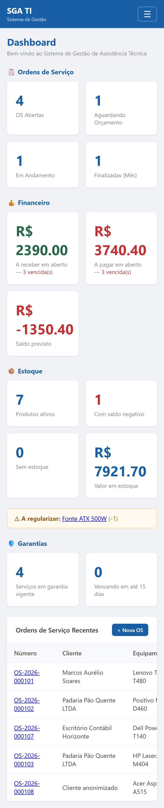
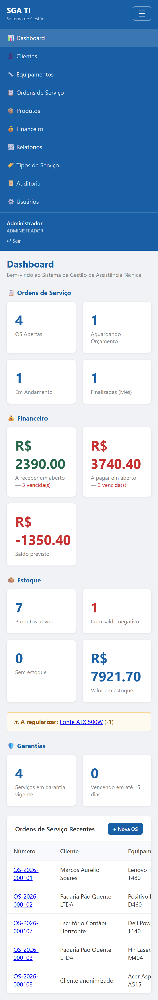
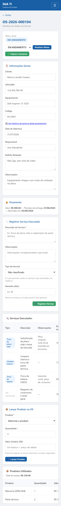

# Plano e resultados de testes

**Referência:** seção 1.6 do documento do TCC
**Versão:** V01 · 12/10/2026
**Commit medido:** `ffadbf5`

Cobre os três tipos de teste previstos: **de software**, **de usabilidade** e
**nos navegadores**.

---

## 1. Testes de software

### 1.1 Resultado consolidado

| Suíte | Casos | Passando | Falhando |
|---|---|---|---|
| Unitários | 356 | 356 | 0 |
| Integração | 348 | 348 | 0 |
| **Total** | **704** | **704** | **0** |

**A suíte inteira passa**, inclusive `npm test`. Até 14/10/2026 havia 3 falhas
permanentes em `tests/integration/auth.test.js` — ver 1.5.

**Comandos:**

```cmd
npm run test:unit         :: 356 testes
npm run test:integration  :: 348 testes
npm test                  :: suíte completa — 704 testes
```

### 1.2 Testes unitários — 356 casos

Exercitam a regra de negócio com o Prisma substituído por dublê. Não tocam
banco, rodam em cerca de 3 segundos.

| Arquivo | Casos | O que cobre |
|---|---|---|
| `produtoService.test.js` | 34 | Cadastro, preço, movimentação e saldo de estoque |
| `financeiroService.test.js` | 30 | Contas a pagar/receber, quitação, cancelamento |
| `itemOrdemService.test.js` | 37 | Peças na OS, baixa de estoque, valor negociado, serviço em que a peça foi usada |
| `ordemServicoService.test.js` | 18 | Travas de status, validação do orçamento, fuso da previsão |
| `relatorioService.test.js` | 26 | Período, agregações dos quatro relatórios |
| `seguranca.test.js` | 27 | NF007 — produção × desenvolvimento de cada proteção; views sem script embutido; limitador que só conta erros |
| `csrf.test.js` | 22 | NF007 — regra do token CSRF; todo formulário POST autenticado leva o token |
| `servicoExecutadoService.test.js` | 21 | Garantia derivada, travas de registro e exclusão, técnico do serviço |
| `auditoriaExtensao.test.js` | 15 | NF005 — gravação automática, senha omitida, contexto |
| `backup.test.js` | 15 | NF006 — leitura da URL, nome do arquivo, argumentos |
| `retencaoService.test.js` | 12 | NF008 — busca do dado pessoal em texto livre |
| `entregaService.test.js` | 28 | Módulo 6 — regras da saída de entrega (RN15–RN25) |
| `geocodificacaoService.test.js` | 15 | Módulo 6 — busca no Nominatim, falhas, timeout e intervalo da fila |
| `entregadorScript.test.js` | 26 | Módulo 6 — mensagens do GPS, idade do envio, reação às respostas do servidor e trava contra rajada (script do celular) |
| `csvService.test.js` | 12 | Separador, BOM, decimal com vírgula |
| `equipamentoService.test.js` | 10 | RF012 — histórico por equipamento, tipo |
| `clienteService.test.js` | 5 | Validações do cadastro |
| `authService.test.js` | 3 | Login e geração de token |

### 1.3 Testes de integração — 348 casos

Sobem a aplicação de verdade (rota, sessão, flash, views, JWT) contra um banco
isolado, recriado a cada suíte.

| Arquivo | Casos | O que cobre |
|---|---|---|
| `api.test.js` | 33 | API REST com JWT, inclusive a criação de usuário restrita ao admin |
| `auditoria.test.js` | 22 | NF005 — gravação automática, acesso, somente-leitura, filtros |
| `retencao.test.js` | 34 | NF008 — anonimização no cadastro, nas contas e no log; reparo; exclusão lógica |
| `perfis.test.js` | 28 | RF022/RF023 — controle de acesso dos 7 perfis |
| `entregas.test.js` | 32 | Módulo 6 — saída, posição, paradas, cancelamento, auditoria, perfis e a tela do entregador |
| `modeloEntregas.test.js` | 20 | Módulo 6 — uma saída em rota, OS em uma só entrega pendente, chaves RESTRICT, perfil ENTREGADOR |
| `tiposServico.test.js` | 18 | RF017/RF019 — catálogo e classificação |
| `relatorios.test.js` | 21 | RF016/RF018 — relatórios por período |
| `dashboard.test.js` | 16 | Blocos por perfil e exportação CSV |
| `estoque.test.js` | 16 | RF014/RF015 — movimentações, saldo × razão |
| `financeiro.test.js` | 15 | RF020/RF021 — contas e a gerada no encerramento |
| `historicoEquipamento.test.js` | 14 | RF012 — histórico por equipamento |
| `garantia.test.js` | 13 | Serviços executados e garantia |
| `servicoTecnicoPeca.test.js` | 11 | Técnico do serviço e peça usada no serviço (RN09–RN12) |
| `seguranca.test.js` | 23 | NF007 — cabeçalhos, cookie e CORS reais; confirmação sem script embutido; limite da consulta pública |
| `csrf.test.js` | 16 | NF007 — 403 sem token, token de outra sessão, regeneração no login, Sair por POST |
| `clientes.test.js` | 7 | API de clientes |
| `auth.test.js` | 9 | Login da API: token, senha errada, usuário inexistente e desativado, campos ausentes |

### 1.4 Onde os testes rodam

| Ambiente | Banco | Quando |
|---|---|---|
| Máquina de desenvolvimento | SQLite isolado (`prisma/test.db`) | A cada execução manual |
| **Integração contínua** | **MySQL 8** | **A cada push e pull request** |

O CI (`.github/workflows/ci.yml`) roda num MySQL 8 de serviço e produz os mesmos
números: **356 unitários e 348 de integração passando**. Isso importa porque o
SQLite não valida SQL gerado, migrations, tipos nativos, `ENUM`, constraints nem
`$transaction` real — tudo isso passou a ser verificado automaticamente.

O CI também roda `prisma migrate deploy` num banco vazio e um
`prisma migrate diff --exit-code` contra o schema: se alguém alterar o
`schema.prisma` sem gerar a migration, **o build quebra**.

`[PRINT: execução do CI no GitHub Actions, com todos os passos verdes]`

### 1.5 O `auth.test.js`, que falhava desde o início

Até 14/10/2026 este arquivo falhava nos seus 3 casos, e por isso `npm test`
sempre saía vermelho:

```
PrismaClientValidationError: Invalid `prisma.usuario.upsert()` invocation
  where: { email: "teste@sgati.com" }
```

O arquivo tinha sido escrito contra um schema que nunca existiu neste projeto,
com `usuario.email` e um campo `perfil` em texto. O model real tem `login` e
`perfilId`. **A rota sempre funcionou** — o teste é que não conseguia nem montar
o cenário.

Foi reescrito contra o schema real, mantendo os três casos originais e
acrescentando os que o serviço já tratava e ninguém verificava: login
inexistente recebendo **a mesma resposta** da senha errada (para não revelar
quais logins existem), usuário desativado barrado mesmo com a senha certa, e o
conteúdo do token sem dado sensível. Passou de 3 casos falhando para 9 passando,
e o CI deixou de precisar excluí-lo.

### 1.6 O que os testes **não** cobrem

Honestidade vale mais que número bonito. Não há cobertura automatizada de:

| # | Lacuna | Por quê |
|---|---|---|
| L01 | **Renderização das telas no navegador** | Os testes de integração leem o HTML da resposta, não executam CSS nem JavaScript. Um botão invisível por CSS passaria |
| L02 | **Comportamento sob HTTPS real** | A lógica do NF007 está testada; o tráfego sob TLS de verdade não foi exercitado — não há ambiente com certificado |
| L03 | **Ciclo de backup e restauração** | Exige `mysqldump` e um MySQL no ar. Ver `docs/BACKUP.md`, seção 5 |
| L04 | **Carga e concorrência** | Nenhum teste de volume. O sistema nunca foi exercitado com dois usuários simultâneos |
| L05 | **Compatibilidade entre navegadores** | É a seção 3 deste documento, ainda não executada |

---

## 2. Testes de usabilidade

### 2.1 Instrumento

O questionário e o roteiro de tarefas estão no **Apêndice A**
(`docs/APENDICE-A-USABILIDADE.md`), pronto para aplicar. Baseia-se na escala
**SUS** adaptada, com perguntas específicas das telas reais do sistema.

### 2.2 Como será aplicado

| Etapa | Descrição | Tempo |
|---|---|---|
| 1 | Preparar o ambiente: sistema no ar, massa de demonstração, seis usuários criados | — |
| 2 | Identificação do participante (Parte 1) | 2 min |
| 3 | **Roteiro de tarefas observadas** (Parte 2), só o bloco do perfil dele | 20–30 min |
| 4 | Escala SUS (Parte 3) | 5 min |
| 5 | Perguntas por tela (Parte 4) | 10 min |
| 6 | Questões abertas (Parte 5) | 5 min |

**A ordem importa:** as tarefas vêm antes do questionário. Questionário
respondido sem uso mede impressão, não usabilidade.

### 2.3 Participantes

| # | Quem | Perfil | Bloco de tarefas |
|---|---|---|---|
| P1 | Consultor — proprietário da Lelo Informática | `ADMINISTRADOR` | C (7 tarefas) + D |
| P2 | Usuário de atendimento | `ATENDENTE` | A (6 tarefas) |
| P3 | Usuário técnico | `TECNICO` | B (6 tarefas) |

### 2.4 O que será medido

| Métrica | Como |
|---|---|
| **Pontuação SUS** | 0 a 100, pela fórmula padrão. Referência de média: 68 |
| **Taxa de conclusão** | Tarefas concluídas sem ajuda ÷ total |
| **Tempo por tarefa** | Cronometrado pelo aplicador |
| **Problemas por gravidade** | Alta (impede), média (atrapalha), baixa (incomoda) |

### 2.5 Resultados

> **Ainda não aplicado.** Preencher após as sessões.

| Participante | Perfil | SUS | Conclusão sem ajuda | Data |
|---|---|---|---|---|
| P1 | Administrador | | | |
| P2 | Atendente | | | |
| P3 | Técnico | | | |
| **Média** | | | | |

**Principais problemas encontrados:**

| # | Problema | Tela | Gravidade | Ação tomada |
|---|---|---|---|---|
| | | | | |
| | | | | |

`[VALIDAR: agendar as sessões com o consultor. É a atividade com maior
dependência externa de todo o fechamento — depende da agenda de terceiros.]`

---

## 3. Testes nos navegadores

### 3.1 Método

Para cada combinação de navegador e tela, verificar:

1. **Renderização** — layout íntegro, sem elemento sobreposto ou cortado;
2. **Função** — formulários enviam, filtros aplicam, confirmações aparecem;
3. **Console** — nenhum erro de JavaScript.

Preencher com: **OK** · **Falha** (descrever) · **—** (não aplicável ao perfil).

### 3.2 Navegadores

| # | Navegador | Versão | Sistema | Testado em |
|---|---|---|---|---|
| N1 | Chromium (motor do Chrome e do Edge) | — | Windows 11 | **13/10/2026** |
| N1b | Google Chrome (instalado) | | Windows 11 | ___/___/______ |
| N2 | Mozilla Firefox | | Windows 11 | ___/___/______ |
| N3 | Microsoft Edge | | Windows 11 | ___/___/______ |
| N4 | Chrome — Android | | Android | ___/___/______ |
| N5 | Safari — iOS | | iOS | ___/___/______ |

### 3.3 Matriz

> A coluna **Chromium** foi executada em 13/10/2026 (resultado na seção 3.6). As
> demais continuam em branco, para preencher ao executar. As colunas de celular
> remetem à seção 3.7, onde o comportamento foi medido.

| # | Tela | Chromium | Firefox | Edge | Android | iOS |
|---|---|:-:|:-:|:-:|:-:|:-:|
| 1 | Login | **OK** | | | ver 3.7 | ver 3.7 |
| 2 | Dashboard — administrador | **OK** | | | ver 3.7 | ver 3.7 |
| 3 | Dashboard — técnico | *não verificado* | | | ver 3.7 | ver 3.7 |
| 4 | Lista de clientes | **OK** | | | ver 3.7 | ver 3.7 |
| 5 | Cadastro de cliente | **OK** | | | ver 3.7 | ver 3.7 |
| 6 | Lista de equipamentos | **OK** | | | ver 3.7 | ver 3.7 |
| 7 | Cadastro de equipamento | **OK** | | | ver 3.7 | ver 3.7 |
| 8 | **Histórico do equipamento** | **OK** | | | ver 3.7 | ver 3.7 |
| 9 | Lista de ordens de serviço | **OK** | | | ver 3.7 | ver 3.7 |
| 10 | Abertura de OS | **OK** | | | ver 3.7 | ver 3.7 |
| 11 | **Detalhe da OS** (a tela mais densa) | **OK** | | | ver 3.7 | ver 3.7 |
| 12 | Lista de produtos | **OK** | | | ver 3.7 | ver 3.7 |
| 13 | Estoque do produto | **OK** | | | ver 3.7 | ver 3.7 |
| 14 | Painel financeiro | **OK** | | | ver 3.7 | ver 3.7 |
| 15 | Lançamento de conta | **OK** | | | ver 3.7 | ver 3.7 |
| 16 | **Relatórios** | **OK** | | | ver 3.7 | ver 3.7 |
| 17 | Exportação CSV | **OK** | | | ver 3.7 | ver 3.7 |
| 18 | Tipos de serviço | **OK** | | | ver 3.7 | ver 3.7 |
| 19 | **Auditoria** | **OK** | | | ver 3.7 | ver 3.7 |
| 20 | Usuários | **OK** | | | ver 3.7 | ver 3.7 |
| 21 | **Consulta pública** | **OK** | | | ver 3.7 | ver 3.7 |

### 3.4 Pontos de atenção

Itens que têm maior chance de divergir entre navegadores — verificar com cuidado:

| # | O quê | Onde | Por quê |
|---|---|---|---|
| A1 | Campo `<input type="date">` | Orçamento, relatórios, auditoria, financeiro | Cada navegador desenha seu próprio seletor; o Safari historicamente diverge mais |
| A2 | Download do CSV | Relatórios | Nome do arquivo e codificação |
| A3 | `confirm()` nas exclusões | Clientes, produtos, serviços, anonimização | Alguns navegadores suprimem diálogos em certas condições |
| A4 | Menu lateral em tela estreita | Todas | Recolhido abaixo de 768 px — **medido antes e depois na seção 3.7** |
| A5 | Tabela do detalhe da OS | Detalhe da OS | É a tabela mais larga do sistema |
| A6 | Emojis dos rótulos | Todas | Renderizam diferente por sistema operacional |

### 3.6 Resultados

**Chromium — executado em 13/10/2026.** Vinte das 21 telas verificadas (a de nº 3
é a mesma da nº 2 com outro perfil e foi deixada para a execução manual):

| Verificação | Resultado |
|---|---|
| Resposta HTTP | **20 de 20 em `200`**, com o conteúdo esperado presente |
| Erros de JavaScript no console | **nenhum**, incluindo as duas telas com `<script>` embutido (abertura de OS e estoque) |
| Transbordo horizontal em 1280 px | **nenhum** |
| Exportação CSV | cabeçalho e separador corretos |

**Falhas encontradas:** nenhuma em Chromium na largura de desktop.

> **Firefox, Edge instalado, Safari e aparelho real continuam por fazer.** O
> ambiente de desenvolvimento tem apenas um navegador baseado em Chromium, que
> é o mesmo motor do Chrome e do Edge — então a linha N1 cobre o motor, não as
> três marcas. Divergências entre Chrome e Edge são improváveis; entre esses e
> o Firefox ou o Safari, não.

### 3.7 Comportamento em tela de celular — medido antes e depois

Medido emulando um aparelho de **375 px** de largura.

**Antes** (até 13/10/2026), o menu lateral tinha 220 px fixos — sozinho, 59 % da
tela — e o CSS não tinha ponto de quebra. O navegador não quebrava o layout:
**encolhia a página inteira** até caber. Um texto de 14 px era desenhado com 6 a
7 px. Não aparecia barra de rolagem horizontal, e era por isso que o problema
passava despercebido — a página "cabia", mas não se lia.

**Depois** de acrescentar o ponto de quebra em 768 px:

| Tela | Antes: viewport | Antes: escala | **Depois: viewport** | **Depois: escala** |
|---|---|---|---|---|
| Abertura de OS | 702 px | 53 % | **375 px** | **100 %** |
| Relatórios | 798 px | 47 % | **375 px** | **100 %** |
| Dashboard | 805 px | 47 % | **375 px** | **100 %** |
| Estoque do produto | 843 px | 44 % | **375 px** | **100 %** |
| Detalhe da OS | 873 px | 43 % | **375 px** | **100 %** |
| Lista de clientes | — | — | **375 px** | **100 %** |
| Auditoria | — | — | **375 px** | **100 %** |
| Financeiro | — | — | **375 px** | **100 %** |
| Histórico do equipamento | — | — | **375 px** | **100 %** |
| Consulta pública | 375 px | 100 % | 375 px | 100 % |

Nenhuma tela com transbordo horizontal.

**O que mudou** (`public/css/style.css`, seção de responsividade, e
`public/js/menu.js`):

- abaixo de 768 px o menu lateral vira uma barra no topo, recolhida atrás de um
  botão ☰ — com `aria-expanded` e `aria-controls`, para leitor de tela;
- a tabela larga **rola dentro da própria caixa**. Antes a `.tabela-box` tinha
  `overflow: hidden`, que **cortava** a tabela;
- formulário de duas colunas vira uma coluna.

**O que se encontrou no caminho.** Depois do ponto de quebra, a abertura de OS
ainda ficava em 94 %. A causa era um `<select>`: por padrão ele assume a largura
da maior opção, e o nome mais comprido de cliente esticava a coluna 26 px além
da tela. Resolvido com `min-width: 0` na coluna da grade.

**Melhoria progressiva.** O menu só fica recolhível depois que o JavaScript
carrega. Se o script falhar, o menu aparece aberto — mais comprido, mas ninguém
fica sem acesso às telas.

**Desktop inalterado.** Conferido em 1024 px: menu de 220 px fixo, botão ☰
oculto, margem de 220 px no conteúdo — exatamente como antes.







### 3.8 Limitação conhecida

| # | Limitação |
|---|---|
| L06 | ~~O sistema não foi projetado para telas de celular~~ — **resolvido**, ver 3.7. O que continua valendo: a emulação reproduz a largura e o toque, mas não substitui um aparelho de verdade. As colunas Android e iOS da matriz ainda pedem teste em aparelho físico |

### 3.9 Tela do entregador em aparelho real (Módulo 6)

**Executado em 16/10/2026, às 21:54 (horário local).** Celular:
`[VALIDAR: modelo, sistema e navegador]`. Acesso por HTTPS através de um túnel
temporário (`cloudflared`, endereço `trycloudflare.com`), porque o GPS do
celular só funciona em `https://` ou em `localhost`. Roteiro em
`TESTE-CELULAR-MODULO6.md`, fora do repositório.

| Verificação | Resultado |
|---|---|
| Login do `entregador` cai direto na tela de entregas | ✅ |
| Iniciar a saída com uma OS | ✅ "Saída iniciada com 1 OS." |
| Pedido de permissão e envio da localização | ✅ faixa verde, "Localização enviada há 8 s" |
| Wake Lock | ✅ o aviso de "Mantenha a tela acesa" não apareceu — o navegador aceitou a trava |
| Posições gravadas | 7, entre 21:54:30 e 21:56:24, precisão de 6 a 13 m |
| Intervalo com a tela acesa | 10 s, como previsto |
| Tela bloqueada | buracos de 45 e 50 s — o navegador pausa o GPS, limitação já prevista (rastrear em segundo plano exigiria app nativo) |
| Destino geocodificado | ✅ |
| Navegar, Entregue e Encerrar | `[VALIDAR]` — a saída ficou em rota ao fim do teste e foi cancelada depois, pelo administrador |
| Trajeto | não medido: o aparelho praticamente não se deslocou (cerca de 2 m) |

**Defeito encontrado.** Ao desbloquear a tela, o navegador disparou de uma vez
os envios que o timer acumulou: **três posições idênticas gravadas no mesmo
milissegundo**. A regra de descartar posição a menos de 5 s da anterior (RN21)
lia a última posição e só depois gravava, e os três envios simultâneos leram a
mesma "última". Corrigido nas duas pontas:

- **servidor:** os registros de posição da mesma saída passam por uma fila
  dentro do processo, e o segundo envio já enxerga o primeiro. Basta porque o
  sistema roda numa instância só, a mesma premissa da sessão em memória
  (`SEGURANCA.md`, P04);
- **celular:** um envio por vez e pelo menos 5 s entre tentativas. Não exige
  posição nova do GPS: parado num semáforo, o entregador continua aparecendo
  como ativo.

Teste de integração com três envios simultâneos (antes: 3 gravados; depois: 1)
e unitário da trava do celular; os dois falham com a correção desligada.

---

## 4. Situação geral

| Tipo de teste | Situação | Evidência |
|---|---|---|
| **Software — unitários** | ✅ Executado | 356 passando, a cada push |
| **Software — integração** | ✅ Executado | 348 passando em SQLite e em MySQL 8 |
| **Software — migrations** | ✅ Executado | CI aplica as 8 e confere contra o schema |
| **Usabilidade** | ⬜ Não executado | Instrumento pronto — Apêndice A |
| **Navegadores** | 🔶 Parcial | Chromium executado (20 telas, 0 falhas) e celular emulado (10 telas a 100 %); tela do entregador em aparelho real (3.9); Firefox, Safari e o restante em aparelho real pendentes |
| **Backup e restauração** | ✅ Executado | Ciclo completo roda no CI a cada push: 17 tabelas comparadas, 0 divergências |
| **Carga e concorrência** | ⬜ Fora de escopo | — |

As três atividades não executadas dependem de ação fora do código: agenda do
consultor, acesso a máquinas com outros navegadores, e um servidor MySQL
instalado.
